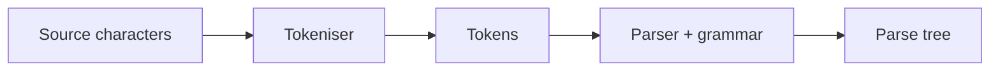
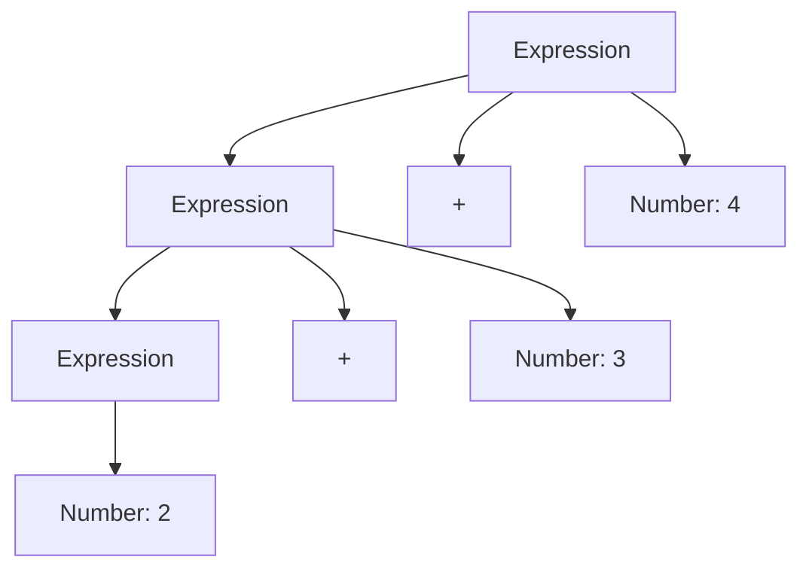

# Tokenisers and Parsers

[Lecture source index and PDF-page navigation](lecture-source-index.md) · **Source key P:** `lecture_parsing - comp21006442 - s2 - 2026(1).pdf`. References use **1-based PDF viewer pages, including the cover**, not printed slide numbers.

A concise revision page for the COMP6442 parsing topic. The explanations follow the supplied parsing lecture. Examples and practice questions labelled supplemental are original study aids; they are not claims about examination coverage.

## 1. The processing pipeline

**Lecture reference:** P pp. 22–25, 41.

A program begins as characters. A tokeniser groups characters into meaningful tokens; a parser checks whether those tokens follow a grammar and builds a structure such as a parse tree.



**Supplemental tokenisation example:** `total = 12.34 + count;` might produce:

```text
IDENTIFIER(total)  ASSIGN(=)  DOUBLE(12.34)  PLUS(+)  IDENTIFIER(count)  SEMICOLON(;)
```

The tokeniser identifies pieces; it does not evaluate the expression. The parser checks how the pieces fit together.

## 2. Tokens and lexical rules

**Lecture reference:** P pp. 28–39.

A token has a **kind** (or type) and may have a **value**. A source location is also useful for reporting errors.

| Source text | Possible token |
| --- | --- |
| `while` | KEYWORD(`while`) |
| `total` | IDENTIFIER(`total`) |
| `12.34` | DOUBLE(`12.34`) |
| `+` | PLUS |
| `(` | LEFT_PAREN |

A **lexical rule** describes which character sequences form tokens. A tokeniser commonly:

- skips whitespace when the language treats it as insignificant;
- distinguishes keywords from identifiers;
- recognises numbers, strings, operators, and punctuation;
- checks longer operators before shorter ones (for example, `==` before `=`);
- preserves case when the language is case-sensitive, as Java is.

### Decimal example: one point per literal

**Lecture reference:** P p. 39. The regex and malformed-input examples below are supplemental illustrations of this simplified scanner.

For a simple decimal format, the rule can be written as:

```text
digits [ "." digits ]
```

The brackets mean “optional.” Thus `12` is an integer and `12.34` is a decimal. The decimal part has one point and at least one digit on each side.

```text
12.34  → DOUBLE("12.34")       valid decimal literal
12.3.4 → DOUBLE("12.3"), DOT, INTEGER("4")   not one valid decimal literal
```

The exact later tokens depend on the language's token rules. The key point is that `12.3.4` cannot be a single double token: the second point breaks the decimal pattern. If the tokeniser does not recognise a standalone dot, tokenisation can instead fail there. If it returns `DOT`, an arithmetic parser whose grammar does not allow it rejects that token.

A supplemental Java check for this simplified decimal format:

```java
static boolean isSimpleDecimal(String text) {
    return text.matches("[0-9]+\\.[0-9]+");
}

// isSimpleDecimal("12.34")  -> true
// isSimpleDecimal("12.3.4") -> false
```

This is deliberately a small teaching rule, not a complete implementation of Java numeric literals. Java also permits forms such as exponents and underscores.

## 3. What the parser does

**Lecture reference:** P pp. 42–69.

A context-free grammar is specified as **G = (V, T, S, P)**: non-terminals (variables), terminals, start symbol and production rules. The lecture writes non-terminals in angle brackets or names such as `E`; `|` denotes alternatives. The grammar's language consists of the terminal strings derivable from `S`. **[P pp. 42–53]**

A grammar describes legal token sequences using **terminals** and **non-terminals** (named structures). Here is a **supplemental left-recursive example**, used to illustrate a parse tree rather than as a directly executable recursive-descent grammar:

```text
Expression → Number | Expression "+" Number
```

This grammar describes a number followed by zero or more additions of another number. A parser can turn `2 + 3 + 4` into a tree:



A **recursive-descent parser** is a top-down approach: it starts at the grammar's start symbol and uses a method for each non-terminal. Each method consumes the tokens that match one of that non-terminal's grammar rules.

The grammar's shape affects the parser. A rule such as `Binary → Binary Digit | Digit` is left-recursive. A direct recursive-descent method would call itself again before consuming input, so it can recurse forever. Rewrite the grammar into a form that consumes a digit first, or use a parser designed for left recursion.

A grammar is **ambiguous** if at least one string in its language has more than one parse tree. Different orders of expanding non-terminals are not, by themselves, evidence of ambiguity if they yield the same tree. For arithmetic, a grammar that does not encode precedence may give different trees for `2 + 3 * 4`, and therefore different evaluation orders. The grammar or parser must define precedence and associativity.

### The Course Grammar: Precedence and Right Recursion

**Lecture reference:** P pp. 59–68.

```text
E → T + E | T
T → F * T | F
F → ( E ) | a
```

Here `a` stands for a number. Multiplication appears inside a term, so it binds more tightly than addition: `2 + 3 * 4` has the structure `Add(2, Mul(3, 4))`, which evaluates to **14**. Parentheses let a complete expression appear as a factor and override precedence.

The rules are **right-recursive**: the recursive `E` or `T` is on the right. Thus `2 + 3 + 4` has structure `Add(2, Add(3, 4))`. Addition hides this associativity choice because both groupings give the same mathematical value; do not assume every operator behaves that way.

**Supplemental associativity check:** if an analogous rule were `E → T - E | T`, then `8 - 3 - 1` would mean `8 - (3 - 1) = 6`, not `(8 - 3) - 1 = 4`. To implement left-associative operators, use a suitable grammar or accumulate a left-hand result in a loop. This subtraction rule is an illustration, not the course's displayed grammar.

### Recursive-Descent Operation and Token Consumption

**Lecture reference:** P pp. 37, 62–69.

The course tokeniser API is:

| Method | Role |
| --- | --- |
| `next()` | Extract and store the next current token. |
| `current()` | Read the current token without advancing. |
| `hasNext()` | Check whether a token remains; it does not extract one. |

For the course grammar:

1. `parseE()` parses a `T`. If the current token is `+`, consume it, recursively parse `E`, and construct `Add(left,right)`; otherwise return the term.
2. `parseT()` does the same with a factor, `*`, and a recursive `T`.
3. `parseF()` either consumes `(`, parses an expression and consumes `)`, or consumes a numeric literal and creates a literal node.

The parser constructs the tree **top-down**; evaluation computes node values **bottom-up**, from leaves towards the root. **[P pp. 56, 62–68]**

**Implementation clarification of the slide pseudocode:** P p. 68 sketches the parenthesis case and literal case without complete validation. A working implementation should check that the closing token really is `)`, consume the literal token, report unexpected tokens/end-of-input and check that the top-level parse leaves no trailing tokens. Otherwise it may accept a valid prefix or fail to advance. Initialising the first current token must be consistent with the tokeniser implementation.

Naïve recursive descent cannot directly handle a left-recursive rule such as `Binary → Binary Digit | Digit`: it calls itself before consuming input. P p. 69 rewrites it as `Binary → Digit Binary | Digit`, preserving the language of nonempty binary strings. For an expression grammar, additionally preserve the intended operator associativity when rewriting.

## 4. Common examination mistakes

**Lecture reference:** P pp. 28–39, 58–71; whole-input checks supplement the lecture pseudocode.

- **Mixing up tokenising and parsing:** tokenising finds token boundaries; parsing checks structure and builds a tree.
- **Making the tokeniser evaluate:** calculating `(1 + 2) * 3` is not tokenisation.
- **Treating characters as tokens automatically:** a token can contain several characters, such as an identifier or `==`.
- **Ignoring token values:** `NUMBER(12)` and `NUMBER(34)` share a token kind but have different values.
- **Forgetting whitespace and case rules:** these depend on the language.
- **Choosing the shortest operator too early:** check for a longer token such as `==` before `=`.
- **Accepting a valid prefix as a valid whole input:** after parsing, check that no unexpected tokens remain.
- **Missing grammar ambiguity or left recursion:** ambiguity can produce multiple trees; left recursion can break a basic recursive-descent parser.
- **Assuming every invalid literal fails at the same stage:** malformed characters may be rejected by the tokeniser, while a sequence of valid tokens in an invalid order is rejected by the parser.

## 5. Supplemental practice questions

The questions below are original examples based on P pp. 28–39 and 47–69; they are not copied examination questions.

### Question 1 — Tokenisation

Tokenise `if (x == 12.34) x = x + 1;` into token kinds. You may omit source locations.

**Solution**

```text
KEYWORD(if), LEFT_PAREN, IDENTIFIER(x), EQUAL_EQUAL,
DOUBLE(12.34), RIGHT_PAREN, IDENTIFIER(x), ASSIGN,
IDENTIFIER(x), PLUS, INTEGER(1), SEMICOLON
```

Whitespace separates tokens here but is not itself returned as a token. The tokeniser checks `==` before `=`.

### Question 2 — Decimal validity

Under the simplified rule `digits [ "." digits ]`, which of these is one valid decimal literal: `7.08`, `7.`, `7.0.8`? Explain.

**Solution**

Only `7.08` is a valid decimal literal. `7.` has no digit after the point, and `7.0.8` contains a second point. A lexer might split the last input into several tokens, but it is not one valid decimal token.

### Question 3 — Grammar and parser

Given `Expression → Number | Expression "+" Number`, can the grammar derive `5 + 6 + 7`? Is this grammar directly suitable for a basic recursive-descent parser?

**Solution**

Yes. It can derive the sequence by repeatedly using `Expression → Expression "+" Number`, ending with `Expression → Number`. It is left-recursive because `Expression` appears first on its own right-hand side. A basic recursive-descent method would call itself without consuming a token, so rewrite the rule, for example:

```text
Expression → Number { "+" Number }
```

Here braces mean “repeat zero or more times.” The parser can read the first number and then consume each `+` and following number.

## Quick reminder

**Characters → tokens → grammatical structure.** The tokeniser applies lexical rules. The parser applies grammar rules and constructs a tree.

