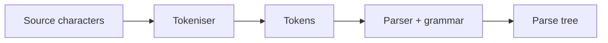
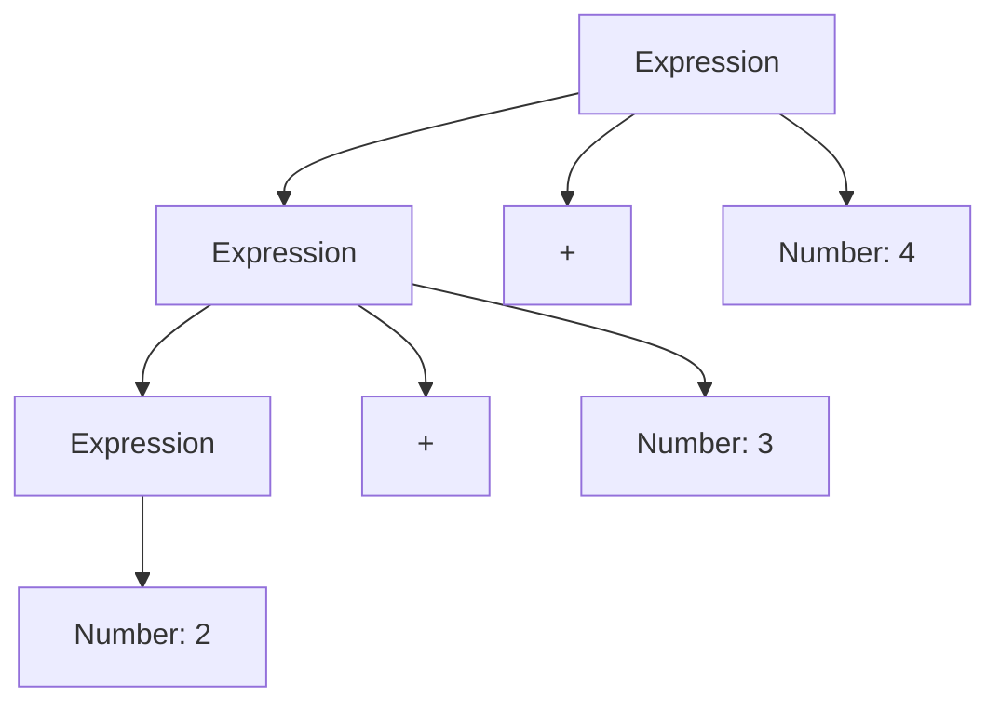

# Tokenisers and Parsers

A concise revision page for the COMP6442 parsing topic. These explanations and examples are original study notes based on the concepts in the parsing lecture.

## 1. The processing pipeline

A program begins as characters. A tokeniser groups characters into meaningful tokens; a parser checks whether those tokens follow a grammar and builds a structure such as a parse tree.



For example, `total = 12.34 + count;` might produce:

```text
IDENTIFIER(total)  ASSIGN(=)  DOUBLE(12.34)  PLUS(+)  IDENTIFIER(count)  SEMICOLON(;)
```

The tokeniser identifies pieces; it does not evaluate the expression. The parser checks how the pieces fit together.

## 2. Tokens and lexical rules

A token has a **kind** (or type) and may have a **value**. A source location is also useful for reporting errors.

| Source text | Possible token |
| --- | --- |
| `while` | KEYWORD(`while`) |
| `total` | IDENTIFIER(`total`) |
| `12.34` | DOUBLE(`12.34`) |
| `+` | PLUS |
| `(` | LEFT_PAREN |

A **lexical rule** describes which character sequences form tokens. A tokeniser commonly:

- skips whitespace when the language treats it as insignificant;
- distinguishes keywords from identifiers;
- recognises numbers, strings, operators, and punctuation;
- checks longer operators before shorter ones (for example, `==` before `=`);
- preserves case when the language is case-sensitive, as Java is.

### Decimal example: one point per literal

For a simple decimal format, the rule can be written as:

```text
digits [ "." digits ]
```

The brackets mean “optional.” Thus `12` is an integer and `12.34` is a decimal. The decimal part has one point and at least one digit on each side.

```text
12.34  → DOUBLE("12.34")       valid decimal literal
12.3.4 → DOUBLE("12.3"), DOT, INTEGER("4")   not one valid decimal literal
```

The exact later tokens depend on the language's token rules. The key point is that `12.3.4` cannot be a single double token: the second point breaks the decimal pattern. A parser for arithmetic expressions would then reject the extra `DOT` token.

A small Java check for this simplified decimal format:

```java
static boolean isSimpleDecimal(String text) {
    return text.matches("[0-9]+\\.[0-9]+");
}

// isSimpleDecimal("12.34")  -> true
// isSimpleDecimal("12.3.4") -> false
```

This is deliberately a small teaching rule, not a complete implementation of Java numeric literals. Java also permits forms such as exponents and underscores.

## 3. What the parser does

A grammar describes legal token sequences using **terminals** (actual token kinds) and **non-terminals** (named structures). For example:

```text
Expression → Number | Expression "+" Number
```

This grammar describes a number followed by zero or more additions of another number. A parser can turn `2 + 3 + 4` into a tree:



A **recursive-descent parser** is a top-down approach: it starts at the grammar's start symbol and uses a method for each non-terminal. Each method consumes the tokens that match one of that non-terminal's grammar rules.

The grammar's shape affects the parser. A rule such as `Binary → Binary Digit | Digit` is left-recursive. A direct recursive-descent method would call itself again before consuming input, so it can recurse forever. Rewrite the grammar into a form that consumes a digit first, or use a parser designed for left recursion.

A grammar is **ambiguous** if one token sequence can have more than one parse tree. For arithmetic, a grammar that does not encode precedence may give different trees for `2 + 3 * 4`, and therefore different evaluation orders. The grammar or parser must define precedence and associativity.

## 4. Common examination mistakes

- **Mixing up tokenising and parsing:** tokenising finds token boundaries; parsing checks structure and builds a tree.
- **Making the tokeniser evaluate:** calculating `(1 + 2) * 3` is not tokenisation.
- **Treating characters as tokens automatically:** a token can contain several characters, such as an identifier or `==`.
- **Ignoring token values:** `NUMBER(12)` and `NUMBER(34)` share a token kind but have different values.
- **Forgetting whitespace and case rules:** these depend on the language.
- **Choosing the shortest operator too early:** check for a longer token such as `==` before `=`.
- **Accepting a valid prefix as a valid whole input:** after parsing, check that no unexpected tokens remain.
- **Missing grammar ambiguity or left recursion:** ambiguity can produce multiple trees; left recursion can break a basic recursive-descent parser.
- **Assuming every invalid literal fails at the same stage:** malformed characters may be rejected by the tokeniser, while a sequence of valid tokens in an invalid order is rejected by the parser.

## 5. Practice questions

### Question 1 — Tokenisation

Tokenise `if (x == 12.34) x = x + 1;` into token kinds. You may omit source locations.

**Solution**

```text
KEYWORD(if), LEFT_PAREN, IDENTIFIER(x), EQUAL_EQUAL,
DOUBLE(12.34), RIGHT_PAREN, IDENTIFIER(x), ASSIGN,
IDENTIFIER(x), PLUS, INTEGER(1), SEMICOLON
```

Whitespace separates tokens here but is not itself returned as a token. The tokeniser checks `==` before `=`.

### Question 2 — Decimal validity

Under the simplified rule `digits [ "." digits ]`, which of these is one valid decimal literal: `7.08`, `7.`, `7.0.8`? Explain.

**Solution**

Only `7.08` is a valid decimal literal. `7.` has no digit after the point, and `7.0.8` contains a second point. A lexer might split the last input into several tokens, but it is not one valid decimal token.

### Question 3 — Grammar and parser

Given `Expression → Number | Expression "+" Number`, can the grammar derive `5 + 6 + 7`? Is this grammar directly suitable for a basic recursive-descent parser?

**Solution**

Yes. It can derive the sequence by repeatedly using `Expression → Expression "+" Number`, ending with `Expression → Number`. It is left-recursive because `Expression` appears first on its own right-hand side. A basic recursive-descent method would call itself without consuming a token, so rewrite the rule, for example:

```text
Expression → Number { "+" Number }
```

Here braces mean “repeat zero or more times.” The parser can read the first number and then consume each `+` and following number.

## Quick reminder

**Characters → tokens → grammatical structure.** The tokeniser applies lexical rules. The parser applies grammar rules and constructs a tree.
