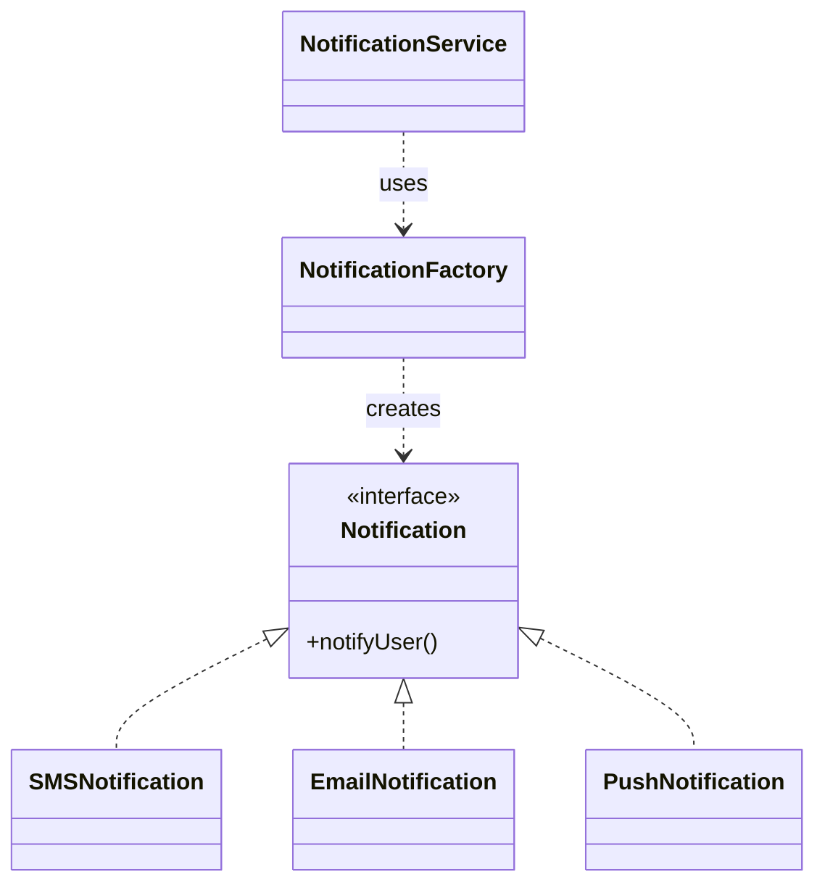
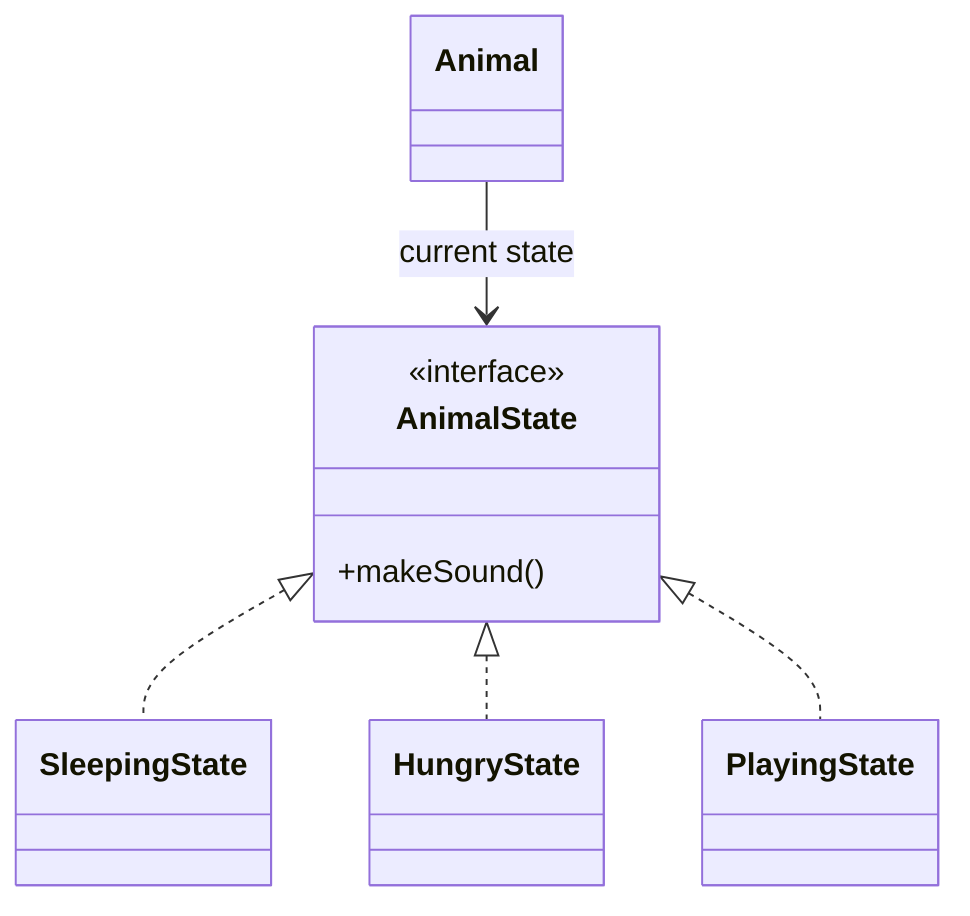

# Week 2: UML and Design Patterns

Source: **U = `week02-uml-dp(6).pdf`**. References below use **1-based PDF viewer pages**, including the cover and administrative slides, not the slide numbers printed on the page. See the [lecture source index](lecture-source-index.md) for the complete course file mapping.

Existing diagrams and detailed examples are retained below. Examples labelled **supplemental** explain a lecture concept but are not copied from a slide. Java fragments are separate examples, not one combined compilation unit; repeated class names belong to separate examples.

## Exam navigation

| Task or question | Read here | PDF pages |
| --- | --- | --- |
| Read/draw a class, interface, visibility or static member | [UML notation](#uml-notation) | U 9-11 |
| Choose a relationship; place arrow/diamond; read multiplicity | [UML relationships](#uml-relationships) | U 14-22 |
| Explain overriding and runtime dispatch | [Inheritance and polymorphism](#inheritance-and-polymorphism) | U 26-34 |
| Choose a pattern from a scenario | [Pattern selector](#pattern-selector) | U 51-52, 62, 94 |
| Factory Method / Singleton | [Creational patterns](#i-creational-patterns) | U 53-58 / 59-61 |
| Observer / State | [Behavioural patterns](#ii-behavioural-patterns) | U 63-68 / 69-77 |
| Template Method / Iterator | [Behavioural patterns](#ii-behavioural-patterns) | U 78-86 / 87-93 |
| DAO / Façade / Decorator | [Structural patterns](#iii-structural-patterns) | U 95-104 / 105-109 / 110-116 |
| Lecture practice questions | UML and pattern checks | U 35-37, 117-118 |

## Unified Modelling Language: building blocks

**Source: U 7-8.** UML describes a system from different perspectives: things, relationships and diagrams. It supports forward design and documentation/reverse engineering; a class diagram does not specify every algorithmic step.

Things (abstraction/elements that will be modelled)
Relationships (relate things/tie them together)
Diagrams (graphical representation of a set of elements (things and relationships))

## Diagrams
### Class Diagram
#### object-oriented approach 
A class diagram shows a set of classes, interfaces, and collaborations and their relationships.

e.g. 


## UML notation

**Source: U 9-11.** A class box has compartments for its name, attributes and operations.

| Notation | Meaning |
| --- | --- |
| `-name: String` | Private attribute with its type |
| `+find(id: int): Item` | Public operation, named parameter and return type |
| `+`, `-`, `#`, `~` | Public, private, protected, package visibility |
| Underlined member | Static/class member |
| Italic class name or operation | Abstract class or operation |
| `<<interface>>` | Interface stereotype |
| `= initialValue` | Optional initial attribute value |

Java package visibility is the default when no access modifier is supplied. For an exam diagram, include only relevant attributes and operations, but keep names, types, visibility and relationships consistent with the code.

## UML Relationships

**Source: U 14-22.**

UML relationships describe **how classes or objects are connected**.

### 1. Generalisation / Inheritance

**Source: U 14-16, 26-29.**
- **Meaning:** one class is a specialised version of another.
- **Relationship:** `is-a`
- Subclass inherits the superclass's:
  - attributes
  - methods/operations
  - relationships
- Example: `Car is a Vehicle`
- UML: solid line + hollow triangle pointing to superclass


### 2. Association

**Source: U 17, 19.** A solid line represents an association. An optional navigability arrow indicates the direction in which an object can navigate to the other.
- **Meaning:** a structural relationship between objects/classes.
- Objects are connected for an ongoing purpose.
- Often includes **multiplicity** (`1`, `0..*`, `1..*`, etc.).
- Example: `Employee works for Organization`
- Think: **"has a connection with"**


### 3. Dependency

**Source: U 17-18.** Use a dashed arrow pointing from the dependent/client to the class it uses.
- **Meaning:** one class temporarily **uses/depends on** another.
- Usually through:
  - method parameters
  - local variables
  - return values / object creation
- Relationship: `uses-a / depends-on`
- Example: `Printer uses Report`
- Generally weaker than association.

A temporary, weak relationship where one class uses another to perform a function, usually as a method parameter, local variable, or method return.
```java
public class CarFactory {

    // Dependency: Car is instantiated and used as a local variable
    public void produceCar(String model) {
        Car car = new Car(model);
        car.assemble();
    }
}
```


### 4. Aggregation

**Source: U 17, 21.**
- **Meaning:** weak whole–part relationship.
- Relationship: `has-a / is-part-of`
- The part **can exist independently** of the whole.
- Example: `Car has an Engine`
- UML: hollow diamond on the **whole** side.

e.g. 
```java
class Engine { 
	private String type; // e.g. "V8" 
} 

class Car { 
	private String model; // e.g. "Mustang" 
    private Engine engine; // aggregated Engine 
}
```


### 5. Composition

**Source: U 17, 20.**
- **Meaning:** strong whole–part relationship.
- The part's lifecycle depends on the whole:
  **parts live and die with the whole**.
- Example: `Order contains Items`
- UML: filled diamond on the **whole** side.


**Composition** is a strong whole–part relationship where the whole owns the parts, and the parts' lifecycle depends on the whole.

```java
public class Order {
    private List<Item> items = new ArrayList<>();

    public void addItem(String name, double price) {
        Item item = new Item(name, price); // Order creates and owns the Item
        items.add(item);
    }
}
```

### Interface realisation

**Source: U 16.** Java `implements` maps to a **dashed line with a hollow triangle pointing to the interface**. Java `extends` between classes maps to a **solid line with a hollow triangle pointing to the superclass**. Do not confuse a realisation triangle with a dependency arrow.

### Relationship exam checks

**Sources: U 18-21; implementation cautions below are explanatory supplements.**

- A stored reference usually supports an association. A parameter or local use commonly supports a dependency.
- A field alone does not prove aggregation or composition: explain whether it represents a whole-part relationship and who owns the part's lifecycle.
- Put the diamond at the **whole**, not the part. Composition means exclusive ownership in the model; aggregation permits an independently existing part.
- `private` alone does not establish composition. Consider whether parts are created, shared or exposed externally.
- Java garbage collection depends on reachability. A UML composition relationship does not cause immediate or guaranteed garbage collection at a particular time.

### Summary


### Multiplicity

**Source: U 22.** The label at the **B end** says how many B instances may relate to **one A**; read the other end separately.

| Label | Number of related instances |
| --- | --- |
| `1` | Exactly one |
| `0..1` | Zero or one |
| `*` or `0..*` | Zero or more |
| `1..*` | One or more |

For the lecture's Employee–Organization association, `1` at Organization means each employee works for one organization; `0..*` at Employee means an organization may have zero or more employees.


### Quick Comparison

| Relationship | Key idea                    | Example                 |
| ------------ | --------------------------- | ----------------------- |
| Inheritance  | **is-a**                    | Car → Vehicle           |
| Association  | **connected-to**            | Employee → Organization |
| Dependency   | **temporarily uses**        | Printer → Report        |
| Aggregation  | **has-a, independent part** | Car → Engine            |
| Composition  | **owns part + lifecycle**   | Order → Item            |

Sequence and use case diagrams are listed among UML diagram types in **U 8**. This lecture's detailed notation coverage focuses on class diagrams.

## Inheritance and polymorphism

**Source: U 26-34.** Inheritance reuses and extends class features. Polymorphism lets an operation behave differently through a common reference type.

For the lecture example `Car f1 = new Ferrari();`, the compiler checks that the method is available through `Car`; an overridden instance method such as `maxSpeed()` runs the `Ferrari` implementation. A `final` method cannot be overridden. Do not infer runtime method behaviour from the reference type alone.


## Design Patterns

**Source: U 43, 47-51.**
**Design patterns are reusable, general solutions to common software design problems.** They are not ready-made code, but templates that guide how to structure a solution.

>main benefits:

- **Reusable solutions** — proven approaches can be applied to different problems and languages.
- **Faster development** — you can reuse established designs instead of inventing everything from scratch.
- **Knowledge transfer** — patterns capture experience from other developers and give teams a shared vocabulary.
- **Better readability** — when developers recognize a familiar pattern, the design is easier to understand.

#### Examples:

- **Singleton** → problem: “How do I ensure there is only one instance of a class?”
- **Observer** → problem: “How do I notify dependent objects when another object changes?”

> **Design pattern = common design problem + reusable generic solution.**

## Design Pattern Classification

**Source: U 51-52, 62, 94.** Class scope uses inheritance; object scope uses object collaboration/composition. Patterns must fit the problem and constraints.
- Creational
- Behavioural
- Structural


## Pattern selector

| Scenario clue | Pattern | Essential structure | PDF pages |
| --- | --- | --- | --- |
| Select which concrete product to create | Factory Method / lecture factory example | Product interface; creation delegated to factory/creator | U 53-58 |
| Exactly one shared instance | Singleton | Private constructor, static instance and accessor | U 59-61 |
| Notify a changing set of subscribers | Observer | Subject maintains observers and calls `update` | U 63-68 |
| Same operation behaves differently in different states | State | Context delegates to its current state object | U 69-77 |
| Fixed algorithm order, variable steps | Template Method | Superclass skeleton calls overridable steps | U 78-86 |
| Traverse while hiding storage representation | Iterator | Collection creates iterator with traversal position | U 87-93 |
| Separate business logic from storage details | DAO | Client uses data-access interface and implementation | U 95-104 |
| One simple entry point to several subsystem operations | Façade | Facade coordinates subsystem collaborators | U 105-109 |
| Add stackable features to one object | Decorator | Wrapper implements and contains the component type | U 110-116 |

For a design question: **identify the problem, choose the pattern, map participant roles to the scenario, show their interaction, and explain the benefit**. This answer structure is a revision aid, not a stated marking rubric.

## I. Creational Patterns

**Source: U 52.**
- Focus on **how objects are created**.
- Hide or abstract the object creation process from the rest of the system.
- Help make the system less dependent on specific classes or creation details.
- **Class-based creational patterns** use **inheritance** to decide what class gets instantiated.
- **Object-based creational patterns** delegate object creation to **another object**.
### 1. Factory Method

**Source: U 53-58; exercise U 117.**

**Terminology note:** U 53 gives the GoF definition involving creator subclasses. U 55-57 then uses a central `NotificationFactory` with conditional selection and calls it Factory Method. Keep the lecture label when locating this example, while recognising that its implementation is a simple conditional factory rather than creator-subclass dispatch.

The **Factory Method** pattern defines an interface for creating objects while allowing the actual object type to be decided separately.

> **Main idea:** defer object creation instead of directly instantiating concrete classes throughout the program.

According to the GoF definition:

- Define an interface for creating an object, but let subclasses decide which class to instantiate.
- Factory Method allows a class to defer instantiation to subclasses.

##### When to Use Factory Method

Use the Factory Method pattern when:

- a class cannot anticipate which type of object it needs to create;
- a class wants subclasses to specify which objects should be created;
- several helper classes can perform a task, and you want to centralise the decision about which helper to use.

---

#### Example: Notification System

Suppose an application supports three notification types:

- SMS
- Email
- Push notification

Instead of letting the client create these objects directly:

```java
new SMSNotification();
new EmailNotification();
new PushNotification();
```

object creation is handled by a `NotificationFactory`.

The client uses `NotificationFactory`; the factory creates one of three implementations of the common `Notification` interface.



The client therefore works mainly with the `Notification` interface rather than concrete notification classes.


#### 1) Product Interface

All notification types implement the same interface:
```java
public interface Notification {

    void notifyUser();

}

```
This gives the different notification objects a common type.

---

#### 2) Concrete Products

##### SMS Notification
```java

public class SMSNotification implements Notification {
    @Override
    public void notifyUser() {

        System.out.println("Sending an SMS Notification!");

    }

}
```


##### Push Notification

```java

public class PushNotification implements Notification {
    @Override
    public void notifyUser() {

        System.out.println("Sending a Push Notification!");

    }

}
```


##### Email Notification

```java

public class EmailNotification implements Notification {
    @Override
    public void notifyUser() {
        System.out.println("Sending an E-Mail Notification!");
    }
}
```
So all three classes can be treated as:
```java
Notification
```
even though their implementations are different.

---

##### Notification Factory

The factory contains the logic that decides which concrete notification object to create.
```java

import java.util.Arrays;
import java.util.List;
import java.util.Random;

public class NotificationFactory {
    public Notification createNotification(String msg, String c) {
        String channel = c;
        // If notification type is not defined,
        // randomly choose one.
        if (channel == null || channel.isEmpty()) {
            List<String> l =
                    Arrays.asList("SMS", "EMAIL", "PUSH");

            Random rand = new Random();
            channel = l.get(
                    rand.nextInt(l.size())
            );
        }
        if ("SMS".equalsIgnoreCase(channel)) {
            return new SMSNotification();
        }

        else if ("EMAIL".equalsIgnoreCase(channel)) {
            return new EmailNotification();
        }

        else if ("PUSH".equalsIgnoreCase(channel)) {
            return new PushNotification();

        }
        return null;
    }
}
```

The important part is:
```java
return new SMSNotification();

return new EmailNotification();

return new PushNotification();
```

These concrete creation decisions are **localised inside the factory**.
The rest of the program does not need to know exactly how each notification object is constructed.

##### Using the Factory

The client asks the factory to create a `Notification`, then uses the returned object through the common interface.

```java
NotificationFactory factory = new NotificationFactory();
Notification notification = factory.createNotification("Hi!", "EMAIL");
notification.notifyUser();
```

---


Before dereferencing the returned notification, consider the unsupported-channel case: the lecture implementation returns `null`. U 58 asks for a payment factory that fails on an unsupported type; an explicit exception is one possible implementation choice. The lecture example accepts `msg` but does not actually use it.

### 2. Singleton

**Source: U 59-61.**
intent: ensures a class only has exactly one instance, and provides a global point of access to it
```java

public class SingletonConnection {

    // Note that the constructor and instance variable are private
    private static SingletonConnection instance = null;

    private SingletonConnection() {}

    // Note that this is the only method that can be accessed
    public static SingletonConnection getInstance() {
        if (instance == null) {
            System.out.println("Instance created!!!!");
            instance = new SingletonConnection();
        } else {
            System.out.println("Instance has already been created!!!!");
        }

        return instance;
    }
}

```
The key Singleton idea here is that the constructor is `private`, so other classes cannot call `new SingletonConnection()` directly. They must use `getInstance()`.

```java
public class SingletonTest {

    public static void main(String args[]) {

        // We cannot instantiate it!
        // SingletonConnection db = new SingletonConnection();

        SingletonConnection.getInstance();
        SingletonConnection.getInstance();
        SingletonConnection.getInstance();
    }
}
```
**Supplemental implementation caution:** this lazy `getInstance()` is not thread-safe; concurrent calls can create more than one object. The lecture code illustrates the basic structure, not concurrent singleton construction. A static getter alone does not ensure a singleton without restricted construction and shared instance storage.

## II. Behavioural Patterns

**Source: U 62.**
- Behavioural patterns organise how responsibilities and interactions are distributed between objects, helping avoid one giant class full of complicated control logic.
- **Behavioural class patterns** use inheritance to distribute behaviour between classes.
- **Behavioural object patterns** use composition, where several objects cooperate to perform a task.
### 1. Observer

**Source: U 63-68.**
Define a one-to-many dependency between objects so that when one object changes state, all its dependents are notified and updated automatically.

Use Observer when:
- one object's change should trigger updates in other objects;
- you don't know how many objects need to be notified;
- you want the subject and observers to remain **loosely coupled**.

#### Subject

```java
public interface Subject {

    // Register an observer
    void attach(Observer observer);

    // Remove an observer
    void detach(Observer observer);

    // Notify all registered observers
    void notifyAllObservers();
}
```

#### Concrete Subject

```java
import java.util.ArrayList;

public class Place implements Subject {

    // One Subject can have many Observers
    private ArrayList<Observer> observers;
    private String name;

    public Place(String name) {
        this.name = name;
        observers = new ArrayList<>();
    }

    // A state change causes all observers to be notified
    public void setCorona() {
        notifyAllObservers();
    }

    @Override
    public void attach(Observer observer) {
        observers.add(observer);
    }

    @Override
    public void detach(Observer observer) {
        observers.remove(observer);
    }

    @Override
    public void notifyAllObservers() {
        for (Observer obs : observers) {
            obs.update(this.name + " has a confirmed case.");
        }
    }
}
```

#### Observer

```java
public interface Observer {

    // Called when the Subject notifies this observer
    void update(String msg);
}
```

#### Concrete Observer
Anyone that **implements `Observer` and therefore has `update()`** can subscribe.

```java
public class Customer implements Observer {

    private String name;

    public Customer(String name) {
        this.name = name;
    }

    @Override
    public void update(String msg) {
        System.out.println(
            "Hey " + this.name + "! Message for you: " + msg
        );
    }
}
```

#### Demo

```java
public class ObserverDemo {

    public static void main(String[] args) {

        Customer c1 = new Customer("Dylan");
        Customer c2 = new Customer("John");
        Customer c3 = new Customer("Lisa");

        Place p1 = new Place("McDonalds");
        Place p2 = new Place("Zara");

        // Subscribe observers
        p1.attach(c1);
        p1.attach(c2);

        p2.attach(c2);
        p2.attach(c3);

        System.out.println("NEW CASE!");
        p1.setCorona();

        // Dylan unsubscribes from McDonalds
        p1.detach(c1);

        System.out.println("NEW CASE!");
        p1.setCorona();

        System.out.println("NEW CASE!");
        p2.setCorona();
    }
}
```

**Key Idea**

When the subject changes, it calls `notifyAllObservers()`, which invokes `update(...)` on each current subscriber. After `p1.detach(c1)`, the next notification from `p1` reaches John but not Dylan [U 67-68].

The **Subject does not need to know the concrete type of its observers** — it only knows that they implement `Observer`. This keeps the objects loosely coupled.

In the Observer Pattern, the **observers depend on the subject for notifications**.
### 2. State

**Source: U 69-77.** The lecture's concrete example is `UserSession`, which holds a `UserState`. `NoSessionState.login(...)` changes it to `SessionState`; `SessionState.logout()` changes it back. `UserSession.createPost(...)` delegates to the current state, so the same operation is allowed or rejected according to the active state.

The role-based and animal examples below are **supplemental analogies**. Roles are a suitable State analogy only when they represent changeable context state governing behaviour; ordinary access-control roles alone do not require this pattern.
>The state pattern allows an object to change its behaviour based on internal or external events.

>Instead of writing lots of `if/else` or `switch` statements for different states, put each state’s behaviour into its own class.

For example, imagine a user in an app can be:

```
Guest
Member
Admin
```

Without the State pattern, you might write:

```
if (userType.equals("guest")) {
    ...
} else if (userType.equals("member")) {
    ...
} else if (userType.equals("admin")) {
    ...
}
```

and repeat this kind of logic everywhere.

With the State pattern, you instead create separate classes:

```
GuestState
MemberState
AdminState
```

that all implement or extend a common type, such as:

```
UserState
```

`GuestState`, `MemberState`, and `AdminState` implement a common `UserState` interface. The context stores one current state object and delegates to it.

Then some main object, often called the **context**, stores the current state:

```
private UserState state;
```

and delegates behavior to it:

```
state.login(...);
state.logout(...);
state.addReply(...);
```

So the context itself doesn’t need to know all the rules.

##### State Design Pattern – Animal Example

###### Core Idea

The **State Design Pattern** allows an object to change its behaviour depending on its current state.

Instead of using lots of `if/else` statements, each state is represented by a separate class.

###### Example: Animal

Imagine an `Animal` can be in three states:

- `SleepingState`
    
- `HungryState`
    
- `PlayingState`
    
The same method:

```java
makeSound()
```

behaves differently depending on the animal's current state.

###### 1. State Interface

```java
interface AnimalState {
    void makeSound();
}
```

All concrete states must implement `makeSound()`.
###### 2. Concrete State Classes

```java
class SleepingState implements AnimalState {
    @Override
    public void makeSound() {
        System.out.println("Zzz...");
    }
}
```

```java
class HungryState implements AnimalState {
    @Override
    public void makeSound() {
        System.out.println("Feed me!");
    }
}
```

```java
class PlayingState implements AnimalState {
    @Override
    public void makeSound() {
        System.out.println("Woof! Let's play!");
    }
}
```

Each state provides its own behaviour for the same method.

###### 3. Context Class

The `Animal` is the **context**. It stores the current state.

```java
class Animal {
    private AnimalState state;

    public Animal(AnimalState state) {
        this.state = state;
    }

    public void setState(AnimalState state) {
        this.state = state;
    }

    public void makeSound() {
        state.makeSound();
    }
}
```

The important line is:

```java
state.makeSound();
```

`Animal` delegates the behaviour to its current state object.

###### 4. Using the States

```java
Animal dog = new Animal(new SleepingState());

dog.makeSound();
// Zzz...

dog.setState(new HungryState());

dog.makeSound();
// Feed me!

dog.setState(new PlayingState());

dog.makeSound();
// Woof! Let's play!
```

We always call:

```java
dog.makeSound();
```

but the behaviour changes because the current `state` object changes.

###### Structure



- `Animal` → Context
    
- `AnimalState` → State interface
    
- `SleepingState`, `HungryState`, `PlayingState` → Concrete states
    

###### Without the State Pattern

```java
if (state.equals("sleeping")) {
    System.out.println("Zzz...");
} else if (state.equals("hungry")) {
    System.out.println("Feed me!");
} else if (state.equals("playing")) {
    System.out.println("Woof! Let's play!");
}
```

The State Pattern avoids repeatedly checking the state with `if/else` by moving each state's behaviour into its own class.

###### Key Takeaway

> **State Pattern:** Put different behaviours into separate state classes, then change an object's behaviour by changing its current state object.

```text
same object
+ same method call
+ different state
= different behaviour
```
### 3. Template Method

**Source: U 78-86.** The lecture uses `ActionReport.generateReport(...)`: **read data → parse content → count actions**, with `CsvActionReport` and `XmlActionReport` overriding parsing. The shared algorithm determines the sequence; subclass implementations supply selected steps. A hook may provide a default implementation; an abstract step must be implemented.

The animal-care example below is **supplemental**. Its `final` template method explicitly prevents overriding the sequence; the lecture's `generateReport` example does not use `final`.
>Define the skeleton of an algorithm in an operation, deferring some steps to subclasses.

>Template Method lets subclasses redefine certain steps of an algorithm without changing the
algorithm's structure.


example:
```java
abstract class AnimalCare {

    // Template method: defines the overall process
    public final void careForAnimal() {
        feed();
        clean();
        exercise();
    }

    // Common step
    void clean() {
        System.out.println("Clean the enclosure");
    }

    // Steps subclasses must define
    abstract void feed();
    abstract void exercise();
}

class DogCare extends AnimalCare {

    @Override
    void feed() {
        System.out.println("Feed dog food");
    }

    @Override
    void exercise() {
        System.out.println("Take the dog for a walk");
    }
}

class PenguinCare extends AnimalCare {

    @Override
    void feed() {
        System.out.println("Feed fish");
    }

    @Override
    void exercise() {
        System.out.println("Let the penguin swim");
    }
}

public class Main {
    public static void main(String[] args) {
        AnimalCare dog = new DogCare();
        dog.careForAnimal();

        System.out.println();

        AnimalCare penguin = new PenguinCare();
        penguin.careForAnimal();
    }
}
```
| Step in `careForAnimal()` | Implementation |
| --- | --- |
| `feed()` | Subclass supplies behaviour |
| `clean()` | Shared superclass implementation |
| `exercise()` | Subclass supplies behaviour |

### 4. Iterator

**Source: U 87-93.**

**API distinction:** the lecture defines its own `Iterator` interface, whose example `next()` returns `null` when exhausted. Java's standard `java.util.Iterator.next()` instead throws `NoSuchElementException` when exhausted. Do not silently treat the lecture's simplified API as the standard library contract.
The **Iterator Pattern** allows a client to traverse elements in a collection **without exposing the collection's internal data structure**.

> Collection stores the data; Iterator controls how the data is traversed.

##### Core Interfaces

```java
public interface Iterator {
    public boolean hasNext();
    public Object next();
}

public interface IterableCollection {
    public Iterator createIterator();
}
```

- `hasNext()` → checks whether another element exists.
- `next()` → returns the next element.
- `createIterator()` → creates an iterator for the collection.

##### Concrete Collection + Iterator

```java
public class FriendsConcreteCollection implements IterableCollection {

    private String names[] = {
        "Friend_1",
        "Friend_2",
        "Friend_3"
    };

    public void addItem() {
        // ...
    }

    @Override
    public Iterator createIterator() {
        return new FriendsConcreteIterator();
    }

    // Inner iterator class
    private class FriendsConcreteIterator implements Iterator {

        int index;

        @Override
        public boolean hasNext() {
            if (names != null && index < names.length) {
                return true;
            }
            return false;
        }

        @Override
        public Object next() {
            if (this.hasNext()) {
                return names[index++];
            }
            return null;
        }
    }
}
```

The collection keeps its internal array `names` private.

The iterator keeps track of the current traversal position using:

```java
int index;
```

This line:

```java
return names[index++];
```

means:

1. Return `names[index]`
2. Increment `index`
3. Move to the next element

So:

```text
index = 0 → Friend_1
index = 1 → Friend_2
index = 2 → Friend_3
```

##### Client Code

```java
public class IteratorDemo {

    public static void main(String[] args) {

        FriendsConcreteCollection f =
            new FriendsConcreteCollection();

        for (Iterator iter = f.createIterator();
             iter.hasNext();) {

            String name = (String) iter.next();
            System.out.println("Name : " + name);
        }
    }
}
```

Output:

```text
Name : Friend_1
Name : Friend_2
Name : Friend_3
```

##### How It Works

The client asks `FriendsConcreteCollection` to create a `FriendsConcreteIterator`, then calls `hasNext()` and `next()` to visit `Friend_1`, `Friend_2`, and `Friend_3` in order.

The client does **not** access:

```java
names[]
```

directly.

Instead, it only communicates with the iterator through:

```java
hasNext()
next()
```

##### Why Use Iterator?

Without Iterator:

```text
Client → directly accesses internal array/list/tree
```

This causes:
- High coupling
- Violation of information hiding
- Client code depending on the collection implementation
- More difficulty changing the internal data structure

With Iterator:

```text
Client → Iterator → Collection
```

The client does not need to know whether the collection uses an:

```text
Array
ArrayList
LinkedList
Tree
Graph
...
```

The internal representation can therefore change without requiring the client traversal code to change.

##### Key Takeaway

> **Iterator provides a standard way to access elements one by one without exposing the collection's internal representation.**

```text
Collection → stores data
Iterator   → traverses data
Client     → uses the iterator
```

## III. Structural Patterns

**Source: U 94.**
### 1. DAO (Data Access Object)

**Source: U 95-104.** DAO handles reading and saving data so the rest of the app does not need to know storage details. The lecture classifies DAO as structural; it is not one of the original GoF 23 patterns.

| Participant | Lecture example | Responsibility |
| --- | --- | --- |
| Data/entity object | `UserActivity` | Carries username, action, content and post ID |
| DAO interface | `UserActivityDaoInterface` | Declares operations such as `createPost`, `likePost`, `findAllPosts`, `deleteAll` |
| Concrete DAO | `UserActivityDao` | Implements the operations using a CSV file |
| Client/business code | State/session functionality | Calls DAO operations instead of performing CSV I/O itself |

Changing CSV to XML should primarily change the persistence implementation behind a stable interface; avoid embedding format-specific parsing throughout client code. In the lecture, the concrete DAO also uses **Singleton**; this is a combination of two patterns, not a requirement of DAO. The exposed `getFilePath()` is an example-specific detail and ties some report functionality to file-based storage.

**Exam distinction:** a data object stores/transfers values; the DAO provides access operations. A factory selects/creates a DAO, whereas the DAO reads/writes data.

### 2. Façade

**Source: U 105-109.** Lecture example: `UserFacade.createPost(...)` coordinates **login → create post → generate report → logout → return `UserDto`**. The client calls one high-level operation. The façade reduces coupling to a collection of subsystem classes and does not require inheritance or polymorphism.

The computer example below is **supplemental** and assumes the collaborators' `start`, `load` and `read` methods exist.
- **Client** → uses the **Facade**
- **Facade** → communicates with several subsystem classes
- The client does not need to understand or coordinate all those classes itself

For example, starting a computer may require several operations:
```java
class ComputerFacade {
    private CPU cpu;
    private Memory memory;
    private HardDrive hardDrive;

    public ComputerFacade(CPU cpu, Memory memory, HardDrive hardDrive) {
        this.cpu = cpu;
        this.memory = memory;
        this.hardDrive = hardDrive;
    }

    public void startComputer() {
        cpu.start();
        memory.load();
        hardDrive.read();
    }
}
```

The client only calls:
```java
computerFacade.startComputer();
```

A Facade provides one simple interface to a complicated collection of classes.
The subsystem still exists and does the real work; the facade merely makes it easier to use.
### 3. Decorator

**Source: U 110-116.** Lecture example: `Pizza`, `PlainPizza`, `PizzaDecorator`, and concrete cheese/pepperoni/mushroom/olive decorators. Each wrapper holds a `Pizza` and implements the same interface. For example, cost delegates to the wrapped pizza and adds the topping cost. The juice example below is **supplemental**.
The **Decorator Pattern** lets us **add or modify an individual object’s behaviour at runtime by wrapping it**, without changing the original class or interface.

Use it when you want to:

- add optional features dynamically;
- avoid creating many subclasses for every feature combination;
- follow the **Open/Closed Principle**;
- modify only specific objects, not every instance of a class.

**Key idea:**  
`original object → wrapped by decorator → gains extra functionality`

Example: `Juice → SugarDecorator → CarrotDecorator` instead of creating separate classes for every juice combination.

```java
// 1. Common interface
interface Juice {
    String getDescription();
    double getPrice();
}

// 2. Basic object
class OrangeJuice implements Juice {

    @Override
    public String getDescription() {
        return "Orange Juice";
    }

    @Override
    public double getPrice() {
        return 5.0;
    }
}

// 3. Base decorator
abstract class JuiceDecorator implements Juice {

    protected Juice juice;

    public JuiceDecorator(Juice juice) {
        this.juice = juice;
    }
}

// 4. Concrete decorator: add sugar
class SugarDecorator extends JuiceDecorator {

    public SugarDecorator(Juice juice) {
        super(juice);
    }

    @Override
    public String getDescription() {
        return juice.getDescription() + " + Sugar";
    }

    @Override
    public double getPrice() {
        return juice.getPrice() + 0.5;
    }
}

// 5. Concrete decorator: add carrot
class CarrotDecorator extends JuiceDecorator {

    public CarrotDecorator(Juice juice) {
        super(juice);
    }

    @Override
    public String getDescription() {
        return juice.getDescription() + " + Carrot";
    }

    @Override
    public double getPrice() {
        return juice.getPrice() + 1.0;
    }
}
```

```java
public class Main {
    public static void main(String[] args) {

        Juice juice = new OrangeJuice();

        System.out.println(juice.getDescription());
        // Orange Juice

        juice = new SugarDecorator(juice);

        System.out.println(juice.getDescription());
        // Orange Juice + Sugar

        juice = new CarrotDecorator(juice);

        System.out.println(juice.getDescription());
        // Orange Juice + Sugar + Carrot

        System.out.println(juice.getPrice());
        // 6.5
    }
}
```


The final wrapper structure is equivalent to `new CarrotDecorator(new SugarDecorator(new OrangeJuice()))`: method calls delegate inward and each wrapper contributes its extra description and price.


## Final comparison and exam traps

**Source navigation: U 117-118; comparisons synthesise the cited pattern sections.**

- **Factory vs Singleton:** choose what to create vs ensure one instance. Neither implies the other.
- **State vs Template Method:** replace the current delegate to change state-specific behaviour vs subclass particular steps of one algorithm skeleton.
- **Observer vs Iterator:** broadcast changes to subscribers vs traverse elements on client request.
- **DAO vs Façade:** isolate persistence operations vs simplify/co-ordinate subsystem operations. A façade can call a DAO.
- **Decorator vs Façade:** preserve a component interface while adding behaviour vs provide a simpler, higher-level subsystem interface.
- A product type may be an interface **or a superclass**. U 117's claim that `Notification` cannot be a superclass is the incorrect alternative.
- U 118 asks for one instance and weak subsystem/client coupling respectively: **Singleton and Façade**.
- Check ownership, arrow direction, multiplicity and required methods before naming a pattern from a diagram. Similar-looking class structures can serve different intentions.
