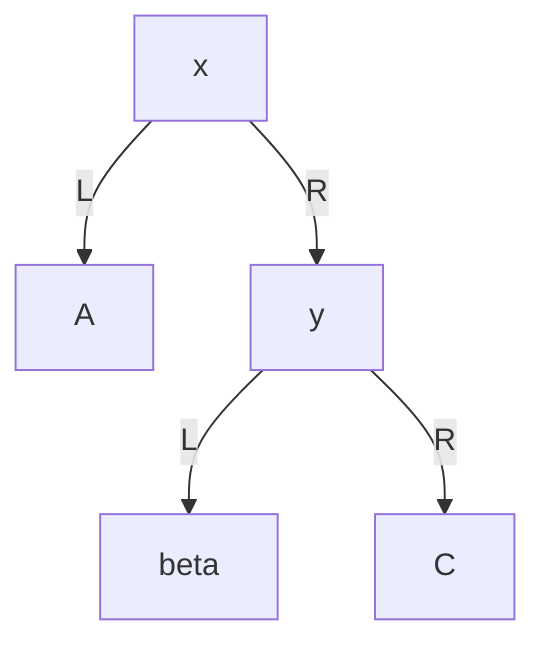
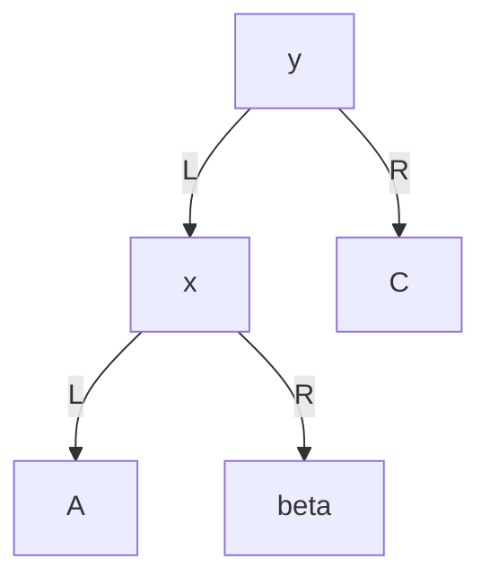
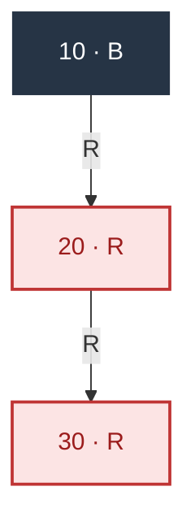
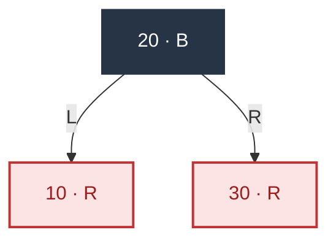
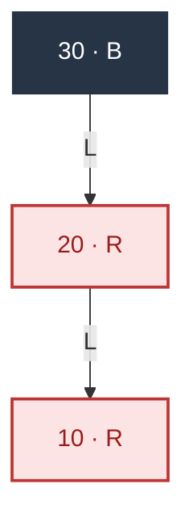
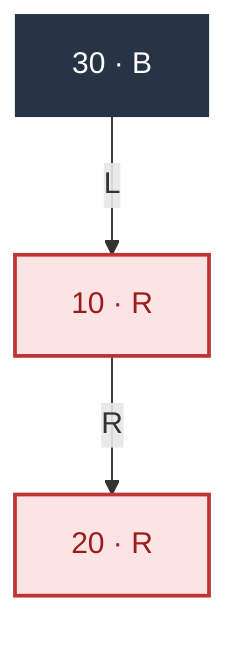
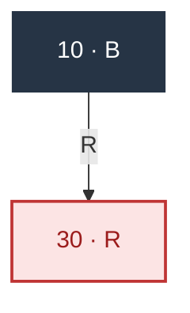
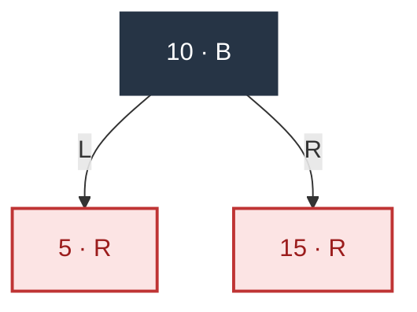
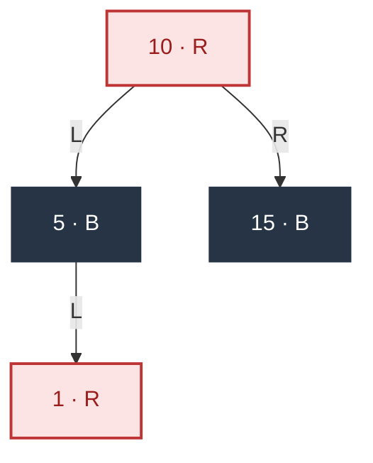
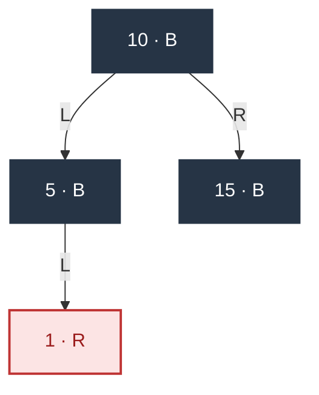

# Red-Black Tree Insertion: Understanding Rotations and Recolouring

> **Core idea:** first find the insertion position using the ordinary BST rules, then repair the colour constraints. Rotations preserve the in-order sequence of keys; rotations combined with appropriate recolouring restore the red-black properties.
>
> This supplement expands “Insertion and Rotation” in [Week 3 — Data Structures](week-03-data-structures.md) and connects it to [Week 7 — Refactoring and B-Trees](week-07-refactoring-and-b-trees.md). The explanations, diagrams and Java implementation were independently written for these notes. They do not reproduce restricted lecture slides or course assessment solutions.

These notes use **conventional bottom-up red-black insertion**, not a left-leaning red-black tree (LLRB). Different valid algorithms can produce different tree shapes. All worked answers here follow the same algorithm as the accompanying Java implementation.

## Reading route

1. Read Sections 1–3: invariants, why new nodes are red, and what a rotation actually changes.
2. Work through Sections 4–6: RR, LL, LR, RL, red uncles and upward propagation.
3. Cover the answers in Section 9 and attempt the exercises in Section 8.
4. Use the Java trace in Section 10 to check your work, one insertion at a time.

## 1. Notation and the invariants we must preserve

| Symbol | Meaning |
| --- | --- |
| `B` / `R` | BLACK / RED; labels also include the colour so diagrams remain readable in monochrome |
| `Z` | The node currently being checked; initially the inserted node, but it may later become a former grandparent |
| `P` / `G` | The parent / grandparent of Z |
| `U` | The uncle: P's sibling, or G's other child; **not** Z's sibling |
| Edge label `L` / `R` | Left child / right child; follow the labels rather than relying on the layout |
| `NIL` | A missing child, treated as a black leaf; represented by `null` in Java |

Most diagrams omit NIL leaves. **Every missing child edge leads to a black NIL.** Diagrams marked “intermediate” may temporarily violate a colour rule. Diagrams marked “complete” must satisfy every invariant.

In addition to BST key ordering, a red-black tree requires:

1. Every node is either red or black.
2. The root is black, and every NIL leaf is black.
3. A red node has two black children: there is no red–red edge.
4. From **any given node**, every downward path to a NIL leaf contains the same number of black nodes. The paths do not have to be equally long.

### Black-height counting convention

The conventional notation `bh(x)` counts black nodes on a path from x down to NIL, **excluding x but including the terminal NIL**. In a valid tree, the choice of path does not affect the result; `bh(NIL)=0`.

For manual checks, these notes often count all black nodes on a **root-to-NIL path, including both the root and the terminal NIL**. The Java checker `check(x)` also includes x if x is black and includes the terminal NIL, so `check(null)=1`. Do not mix these two counting conventions.

For example, if `20B` has red children `10R` and `30R`, every root-to-NIL path contains 2 black nodes—20 and NIL—whereas `bh(20)=1`.

## 2. Why is a new node initially red?

BST insertion replaces one NIL edge with a new node and its two NIL children.

- **Insert a red node:** paths through that position gain a red node, so their black-node counts remain unchanged.
- **Insert a black node:** only paths through that position gain a black node, usually breaking equal black-height immediately.

Therefore, inserting red preserves both BST ordering and equal black-height. The only possible colour violations are a **temporarily red root** or a **red node with a red parent**.

| State after insertion | Next action and reason |
| --- | --- |
| Z is the root | Make it black; all root-to-NIL paths gain one black node together |
| P is black | Finish; there is no red–red edge, and black-height has not changed |
| P and U are both red | Make P and U black, make G red, then continue from `Z=G` |
| P is red and U is black, including NIL | Use the G→P→Z directions to choose rotations and recolouring |

**Check the parent first, then the uncle, and only then LL/RR/LR/RL.** If the uncle is red, use the red-uncle branch even when the shape looks like LL.

## 3. What does a rotation actually do?

### 3.1 Left rotation at x: promote its right child

Suppose `x < y`, and the three subtrees satisfy `A < x < beta < y < C`. Each inequality describes the range of all keys in that subtree.

**Before rotation:**



**After `rotateLeft(x)`:**



Both diagrams have the same in-order sequence: `A, x, beta, y, C`.

**Beta moves from y's left side to x's right side because its keys lie between x and y.** We must neither lose beta nor put it on x's left side.

### 3.2 Right rotation at y: promote its left child

Start with the second diagram and apply `rotateRight(y)`. This restores the first diagram: x rises, y moves down to the right, and beta moves from `x.right` to `y.left`. It is the exact mirror of a left rotation.

### 3.3 Which references must the code update?

| Update during a left rotation at x | Reason |
| --- | --- |
| `x.right = y.left` | Transfer beta |
| If beta exists, `beta.parent = x` | Preserve the parent link |
| `y.parent = x.parent` | Let y take x's position under the old parent |
| Update the old parent's left/right reference, or update root | Reconnect the new subtree root to the rest of the tree |
| `y.left = x`; `x.parent = y` | Make x the left child of y |

The rotation functions **do not swap keys or change colours**. They preserve BST ordering and reconnect the nodes. A rotation alone does not guarantee the red-black properties; the repair logic supplies the recolouring. Each rotation changes a fixed number of references, so it takes `O(1)` time.

## 4. Black uncle: the four basic cases

LL, RR, LR and RL name the two directions **from G to P, then from P to Z**. For example, RR means “right, right”, but its repair uses a **left rotation at G**. The case name is not the rotation direction.

| Case, with P red and U black | First straighten an inner bend | Final outer repair | Rotations |
| --- | --- | --- | --- |
| LL | None | P black, G red; right-rotate G | 1 |
| RR | None | P black, G red; left-rotate G | 1 |
| LR | Left-rotate the original P to obtain LL | Identify the new P/G; P black, G red; right-rotate G | 2 |
| RL | Right-rotate the original P to obtain RR | Identify the new P/G; P black, G red; left-rotate G | 2 |

### 4.1 RR: insert 10, 20, 30

After inserting 10, make the root black. Insert 20 as its right child. Since parent 10 is black, no repair is needed.

**After inserting 10 and 20 — complete:**


Insert 30 as the right child of 20. Now `Z=30R, P=20R, G=10B, U=NIL(B)`. The path 10→20→30 is RR.

**After attaching 30, before repair — intermediate:**



Make 20 black and 10 red, then left-rotate 10. The middle key, 20, rises, with 10 and 30 on either side.

**After the RR repair — complete:**



Every root-to-NIL path now contains 2 black nodes, no red–red edge remains, and the in-order sequence is still `10,20,30`. Rotating without recolouring would leave a red root and unequal black-node counts, so the recolouring is necessary.

### 4.2 LL: insert 30, 20, 10

**After the first two insertions — complete:**


After attaching 10, `Z=10R, P=20R, G=30B, U=NIL(B)`. The path 30→20→10 is left, left.

**After attaching the third key, before repair — intermediate:**



Make 20 black and 30 red, then right-rotate 30. Node 20 rises; 10 and 30 become its red children. Every root-to-NIL path contains 2 black nodes, and the in-order sequence is unchanged.

**After recolouring and the outer rotation — complete:**


### 4.3 LR: insert 30, 10, 20

**After the first two insertions — complete:**


After attaching 20, `Z=20R, P=10R, G=30B, U=NIL(B)`. The path 30→10→20 is left, right: an inner bend.

**After attaching the third key, before repair — intermediate:**



First left-rotate the original parent, 10. Do not recolour in this step.

**After the first rotation: the bend becomes LL — intermediate:**


Node 20 is now the left child of 30, and 10 is the left child of 20. **Treat 10 as the current Z**: the new P is 20 and G is 30. Make 20 black and 30 red, then right-rotate 30.

**After recolouring and the outer rotation — complete:**


### 4.4 RL: insert 10, 30, 20

**After the first two insertions — complete:**



After attaching 20, `Z=20R, P=30R, G=10B, U=NIL(B)`. The path 10→30→20 is right, left.

**After attaching the third key, before repair — intermediate:**


First right-rotate the original parent, 30. Do not recolour in this step.

**After the first rotation: the bend becomes RR — intermediate:**


Node 20 is now the right child of 10, and 30 is the right child of 20. **Treat 30 as the current Z**: the new P is 20 and G is 10. Make 20 black and 10 red, then left-rotate 10.

**After recolouring and the outer rotation — complete:**


### 4.5 Why does the outer rotation use this recolouring?

Consider LL: G is black, P is red and U is black. Before repair, G contributes the local black node. After repair, the promoted P contributes it instead.

- Paths into the original P subtrees previously passed through black G and red P; they now pass through black P.
- Paths into U previously passed through black G; they now pass through black P and red G.

Both groups preserve their original black-node counts. The new subtree root P is black, so it cannot form a red–red edge with a parent higher in the tree. The first rotation in LR/RL simply transforms the bend into this same outer structure; the second step uses the same reasoning.

## 5. Red uncle: recolour and move the check upward

Starting from an empty tree, insert `10,5,15,1`. After the first three insertions:

**After inserting 10, 5 and 15 — complete:**



After inserting 1, `Z=1R, P=5R, G=10B, U=15R`. Although G→P→Z looks like LL, the uncle is red, so use the red-uncle branch.

**After attaching 1 — intermediate:**


Make 5 and 15 black, make 10 red, and set `Z=10`. There is no rotation here.

**After recolouring, before making the root black — intermediate:**



Node 10 is already the root, so the loop stops. Finally, make the root black.

**Insertion of 1 — complete:**



### Why not just make P black?

Making only P black would add one black node to paths through P but leave paths through U unchanged.

Making **both P and U black and G red** preserves the local count: every path previously received one black node from G; afterwards it receives one from either P or U. However, **G is now red and may conflict with its own parent**, so we must continue from `Z=G`.

If G is the root, making it black adds one black node uniformly to every root-to-NIL path, preserving equality. The final diagram above has 3 black nodes on each root-to-NIL path.

## 6. Combined examples: recolouring does not always finish the job

### 6.1 Insert 1 through 8: recolouring followed by a rotation higher up

First insert `1,2,3,4,5,6,7` in that order. The table gives the exact completed state after each insertion so the starting tree can be reproduced from empty.

Compact notation `kB(left,right)` describes a black node k; `.` means a black NIL.

| Inserted through | Completed tree | Repair during this insertion |
| --- | --- | --- |
| 1 | `1B(.,.)` | Make the root black |
| 2 | `1B(.,2R(.,.))` | Black parent; no repair |
| 3 | `2B(1R(.,.),3R(.,.))` | RR: left-rotate 1 and recolour |
| 4 | `2B(1B(.,.),3B(.,4R(.,.)))` | Red-uncle recolouring; make the root black |
| 5 | `2B(1B(.,.),4B(3R(.,.),5R(.,.)))` | RR: left-rotate 3 and recolour |
| 6 | `2B(1B(.,.),4R(3B(.,.),5B(.,6R(.,.))))` | Red-uncle recolouring; move to 4, whose parent is black |
| 7 | `2B(1B(.,.),4R(3B(.,.),6B(5R(.,.),7R(.,.))))` | RR: left-rotate 5 and recolour |

**After inserting 1 through 7 — complete:**

```mermaid
flowchart TD
    n0["2 · B"]:::b
    n1["1 · B"]:::b
    n0 -->|L| n1
    n2["4 · R"]:::r
    n3["3 · B"]:::b
    n2 -->|L| n3
    n4["6 · B"]:::b
    n5["5 · R"]:::r
    n4 -->|L| n5
    n6["7 · R"]:::r
    n4 -->|R| n6
    n2 -->|R| n4
    n0 -->|R| n2
    classDef b fill:#263445,color:#fff,stroke:#263445;
    classDef r fill:#fce4e4,color:#9b1c1c,stroke:#bf3434,stroke-width:2px;
    classDef nil fill:#edf0f4,color:#263445,stroke:#667085;
```

Insert 8. Now `Z=8, P=7R, G=6B, U=5R`, so start with the red-uncle case.

**8 attached, before repair — intermediate:**

```mermaid
flowchart TD
    n0["2 · B"]:::b
    n1["1 · B"]:::b
    n0 -->|L| n1
    n2["4 · R"]:::r
    n3["3 · B"]:::b
    n2 -->|L| n3
    n4["6 · B"]:::b
    n5["5 · R"]:::r
    n4 -->|L| n5
    n6["7 · R"]:::r
    n7["8 · R"]:::r
    n6 -->|R| n7
    n4 -->|R| n6
    n2 -->|R| n4
    n0 -->|R| n2
    classDef b fill:#263445,color:#fff,stroke:#263445;
    classDef r fill:#fce4e4,color:#9b1c1c,stroke:#bf3434,stroke-width:2px;
    classDef nil fill:#edf0f4,color:#263445,stroke:#667085;
```

Make 7 and 5 black, make 6 red, and set `Z=6`. The original 7–8 conflict disappears, but there is now a **4R–6R** conflict.

**After the first recolouring — intermediate:**

```mermaid
flowchart TD
    n0["2 · B"]:::b
    n1["1 · B"]:::b
    n0 -->|L| n1
    n2["4 · R"]:::r
    n3["3 · B"]:::b
    n2 -->|L| n3
    n4["6 · R"]:::r
    n5["5 · B"]:::b
    n4 -->|L| n5
    n6["7 · B"]:::b
    n7["8 · R"]:::r
    n6 -->|R| n7
    n4 -->|R| n6
    n2 -->|R| n4
    n0 -->|R| n2
    classDef b fill:#263445,color:#fff,stroke:#263445;
    classDef r fill:#fce4e4,color:#9b1c1c,stroke:#bf3434,stroke-width:2px;
    classDef nil fill:#edf0f4,color:#263445,stroke:#667085;
```

Identify the relatives again: `Z=6R, P=4R, G=2B, U=1B`. The uncle is now the actual black node 1, not the old uncle 5. This is RR: make 4 black and 2 red, then left-rotate 2.

Notice that **subtree 3B moves from `4.left` to `2.right`**. It is the beta subtree from Section 3.

**After repairing the upper RR conflict — complete:**

```mermaid
flowchart TD
    n0["4 · B"]:::b
    n1["2 · R"]:::r
    n2["1 · B"]:::b
    n1 -->|L| n2
    n3["3 · B"]:::b
    n1 -->|R| n3
    n0 -->|L| n1
    n4["6 · R"]:::r
    n5["5 · B"]:::b
    n4 -->|L| n5
    n6["7 · B"]:::b
    n7["8 · R"]:::r
    n6 -->|R| n7
    n4 -->|R| n6
    n0 -->|R| n4
    classDef b fill:#263445,color:#fff,stroke:#263445;
    classDef r fill:#fce4e4,color:#9b1c1c,stroke:#bf3434,stroke-width:2px;
    classDef nil fill:#edf0f4,color:#263445,stroke:#667085;
```

Every root-to-NIL path contains 3 black nodes. For example, compare `4B→2R→1B→NIL` with `4B→6R→7B→8R→NIL`. The second path is longer, but the black-node count is the same.

### 6.2 Continue with 9 and 10: two successive red-uncle recolourings

Inserting 9 creates an RR case below 7. Left-rotate 7 with recolouring:

**After inserting 9 — complete:**

```mermaid
flowchart TD
    n0["4 · B"]:::b
    n1["2 · R"]:::r
    n2["1 · B"]:::b
    n1 -->|L| n2
    n3["3 · B"]:::b
    n1 -->|R| n3
    n0 -->|L| n1
    n4["6 · R"]:::r
    n5["5 · B"]:::b
    n4 -->|L| n5
    n6["8 · B"]:::b
    n7["7 · R"]:::r
    n6 -->|L| n7
    n8["9 · R"]:::r
    n6 -->|R| n8
    n4 -->|R| n6
    n0 -->|R| n4
    classDef b fill:#263445,color:#fff,stroke:#263445;
    classDef r fill:#fce4e4,color:#9b1c1c,stroke:#bf3434,stroke-width:2px;
    classDef nil fill:#edf0f4,color:#263445,stroke:#667085;
```

After attaching 10, it forms a red–red edge with 9. Here `P=9, G=8, U=7`; both P and U are red.

**10 attached — intermediate:**

```mermaid
flowchart TD
    n0["4 · B"]:::b
    n1["2 · R"]:::r
    n2["1 · B"]:::b
    n1 -->|L| n2
    n3["3 · B"]:::b
    n1 -->|R| n3
    n0 -->|L| n1
    n4["6 · R"]:::r
    n5["5 · B"]:::b
    n4 -->|L| n5
    n6["8 · B"]:::b
    n7["7 · R"]:::r
    n6 -->|L| n7
    n8["9 · R"]:::r
    n9["10 · R"]:::r
    n8 -->|R| n9
    n6 -->|R| n8
    n4 -->|R| n6
    n0 -->|R| n4
    classDef b fill:#263445,color:#fff,stroke:#263445;
    classDef r fill:#fce4e4,color:#9b1c1c,stroke:#bf3434,stroke-width:2px;
    classDef nil fill:#edf0f4,color:#263445,stroke:#667085;
```

First round: make 9 and 7 black, make 8 red, and set `Z=8`. Now 6R–8R is a conflict.

**After the first recolouring — intermediate:**

```mermaid
flowchart TD
    n0["4 · B"]:::b
    n1["2 · R"]:::r
    n2["1 · B"]:::b
    n1 -->|L| n2
    n3["3 · B"]:::b
    n1 -->|R| n3
    n0 -->|L| n1
    n4["6 · R"]:::r
    n5["5 · B"]:::b
    n4 -->|L| n5
    n6["8 · R"]:::r
    n7["7 · B"]:::b
    n6 -->|L| n7
    n8["9 · B"]:::b
    n9["10 · R"]:::r
    n8 -->|R| n9
    n6 -->|R| n8
    n4 -->|R| n6
    n0 -->|R| n4
    classDef b fill:#263445,color:#fff,stroke:#263445;
    classDef r fill:#fce4e4,color:#9b1c1c,stroke:#bf3434,stroke-width:2px;
    classDef nil fill:#edf0f4,color:#263445,stroke:#667085;
```

Second round: identify the new `P=6R, G=4B, U=2R`. The uncle is still red, so make 6 and 2 black, make 4 red, and set `Z=4`.

**After the second recolouring — intermediate:**

```mermaid
flowchart TD
    n0["2 · B"]:::b
    n1["1 · B"]:::b
    n0 -->|L| n1
    n2["4 · R"]:::r
    n3["3 · B"]:::b
    n2 -->|L| n3
    n4["5 · B"]:::b
    n5["6 · R"]:::r
    n4 -->|R| n5
    n2 -->|R| n4
    n0 -->|R| n2
    classDef b fill:#263445,color:#fff,stroke:#263445;
    classDef r fill:#fce4e4,color:#9b1c1c,stroke:#bf3434,stroke-width:2px;
    classDef nil fill:#edf0f4,color:#263445,stroke:#667085;
```

Node 4 is the root, so finish by making it black. Inserting 10 requires **zero rotations**, even though recolouring passes through multiple levels.

**After inserting 10 — complete:**

```mermaid
flowchart TD
    n0["4 · B"]:::b
    n1["2 · B"]:::b
    n2["1 · B"]:::b
    n1 -->|L| n2
    n3["3 · B"]:::b
    n1 -->|R| n3
    n0 -->|L| n1
    n4["6 · B"]:::b
    n5["5 · B"]:::b
    n4 -->|L| n5
    n6["8 · R"]:::r
    n7["7 · B"]:::b
    n6 -->|L| n7
    n8["9 · B"]:::b
    n9["10 · R"]:::r
    n8 -->|R| n9
    n6 -->|R| n8
    n4 -->|R| n6
    n0 -->|R| n4
    classDef b fill:#263445,color:#fff,stroke:#263445;
    classDef r fill:#fce4e4,color:#9b1c1c,stroke:#bf3434,stroke-width:2px;
    classDef nil fill:#edf0f4,color:#263445,stroke:#667085;
```

## 7. Connections to the existing BST, AVL and B-tree notes

### 7.1 BST ordering still applies

A red-black tree is still a BST, so the algorithms for predecessor, successor, minimum and maximum remain applicable. A rotation changes the shape but not the in-order sequence, so the preceding and following keys in sorted order do not change.

**Study deletion separately:** the ordinary BST deletion in Week 3 handles keys and links, but directly applying it does not guarantee red-black black-height. Red-black deletion needs its own colour repair. The Java example here implements insertion only, not deletion.

### 7.2 Similarities to and differences from AVL

| Comparison | AVL | Red-black tree in these notes |
| --- | --- | --- |
| Balance constraint | Left/right subtree heights differ by at most 1 at each node | Equal black-height and no consecutive red nodes |
| Evidence that insertion needs repair | Balance factor goes out of range | A red node conflicts with its red parent |
| LL/RR/LR/RL | Directions along the imbalance path | Directions G→P→Z; uncle colour must also be checked |
| Rotation mechanism | Local pointer reconnection | The same local pointer reconnection, with separate recolouring |

An AVL habit such as “see LL, rotate right” cannot be applied unconditionally to a red-black tree: **a red uncle requires recolouring first**.

### 7.3 Connect to Week 7: group red children with their black parent

Conceptually grouping each black node with its direct red children produces a node of a **2–3–4 tree**:

| Local red-black structure | One grouped multi-key node |
| --- | --- |
| Black node with no red children | 1 key: a 2-node |
| Black node with 1 red child | 2 keys: a 3-node |
| Black node with 2 red children | 3 keys: a 4-node |

For example, `10B` with children `5R,15R` can be viewed as `[5,10,15]`. In this red-uncle case, making 5 and 15 black and 10 red can be understood as splitting that 4-node and moving its middle key, 10, into the group above. If 10 is the root, making it black establishes a new level.

This explains why repair may propagate upward. It does **not** mean the two implementations or all their intermediate states correspond step for step. Under Week 7's definition of **order as the maximum number of children**, a 2–3–4 tree has **order 4**, not order 3. An order-3 B-tree holds at most 2 keys in a node, so `[5,10,15]` cannot be one of its nodes.

### 7.4 Complexity and the teaching code's extra work

- A red-black tree has height `O(log n)`, so finding the insertion position takes `O(log n)`.
- Red-uncle recolouring may propagate through `O(log n)` levels.
- In the conventional algorithm used here, one insertion performs at most **2 rotations**. The red-uncle branch moves upward; the black-uncle branch uses at most a double rotation and resolves the conflict.
- Therefore, the insertion algorithm itself takes `O(log n)` worst-case time. Tree storage is `O(n)`.
- **The teaching implementation also validates the whole tree after each insertion and, in trace mode, prints the whole tree.** Validation is `O(n)`; output and repeated string construction add further work. Do not use this instrumented program's timing to infer the standard insertion complexity. The validator's recursion stack is `O(log n)` on a valid tree; insertion repair itself is iterative and uses `O(1)` auxiliary space.

## 8. Manual tracing exercises — cover the answers first

All exercises use integer-set semantics: duplicate keys are ignored. Finish repairing each insertion before beginning the next one.

Record: `inserted key → BST position → Z/P/G/U and colours → branch → rotation pivot → recolouring → completed tree`. Write “not applicable” when a relative need not be inspected, for example when P is already black.

| Exercise | Task |
| --- | --- |
| A | Starting from empty each time, insert `(24,12,6)`, `(6,12,24)`, `(24,6,12)` and `(6,24,12)`. Identify the final insertion's case, every rotation pivot and the final colours. |
| B | Insert `20,10,30,5` from empty. Why should the final insertion not immediately use an LL right rotation? Draw the states before recolouring, after recolouring and after completion. |
| C | Insert `50,40,30,10,20,5` from empty. Draw the completed tree after every insertion and show both rotations when inserting 20. |
| D | Start from Section 6.1's completed tree for `1..7`, then insert 8. Who are Z/P/G/U after the first recolouring? Which nonempty subtree moves during the rotation? |
| E | Start from Section 6.2's completed tree for `1..9`, then insert 10. How many red-uncle recolourings and rotations are needed? What is the final root-to-NIL black-node count? |
| F | Consider a BST rotation independently: x=10, its right child y=20, `x.left=A={5}`, `y.left=beta={15}`, `y.right=C={30}`. After left-rotating 10, where is 15? Give both in-order sequences. Does rotation alone guarantee the red-black properties? |
| G | Evaluate and explain: (1) We can return immediately after red-uncle recolouring. (2) A missing uncle does not count as a black uncle. (3) Making the root black affects only one path. (4) A rotation changes some key's successor. |
| H | Run the Java example with `10 20 30 20`. What happens to the second 20? Give the final in-order sequence and tree. Explain why a correct in-order sequence is insufficient to validate a red-black tree. |

---

## 9. Detailed answers

### A. The four directions

| Sequence | Z/P/G/U after attaching the third key | Case and repair |
| --- | --- | --- |
| 24,12,6 | 6R / 12R / 24B / NIL(B) | LL: 12 black, 24 red; right-rotate 24 |
| 6,12,24 | 24R / 12R / 6B / NIL(B) | RR: 12 black, 6 red; left-rotate 6 |
| 24,6,12 | 12R / 6R / 24B / NIL(B) | LR: left-rotate 6; identify the new relatives; 12 black, 24 red; right-rotate 24 |
| 6,24,12 | 12R / 24R / 6B / NIL(B) | RL: right-rotate 24; identify the new relatives; 12 black, 6 red; left-rotate 6 |

All four produce the same final tree: middle key 12 is the black root, and 6 and 24 are red children. Every root-to-NIL path contains 2 black nodes.

```mermaid
flowchart TD
    n0["12 · B"]:::b
    n1["6 · R"]:::r
    n0 -->|L| n1
    n2["24 · R"]:::r
    n0 -->|R| n2
    classDef b fill:#263445,color:#fff,stroke:#263445;
    classDef r fill:#fce4e4,color:#9b1c1c,stroke:#bf3434,stroke-width:2px;
    classDef nil fill:#edf0f4,color:#263445,stroke:#667085;
```

### B. Check the red uncle first

After inserting 20, 10 and 30, root 20B has red children 10R and 30R. When 5 is attached, `Z=5R, P=10R, G=20B, U=30R`.

**After attaching 5 — intermediate:**

```mermaid
flowchart TD
    n0["20 · B"]:::b
    n1["10 · R"]:::r
    n2["5 · R"]:::r
    n1 -->|L| n2
    n0 -->|L| n1
    n3["30 · R"]:::r
    n0 -->|R| n3
    classDef b fill:#263445,color:#fff,stroke:#263445;
    classDef r fill:#fce4e4,color:#9b1c1c,stroke:#bf3434,stroke-width:2px;
    classDef nil fill:#edf0f4,color:#263445,stroke:#667085;
```

Recolour 10 and 30 black, and 20 red; move Z up to 20. Since Z is the root, finally make 20 black.

**After recolouring, before making the root black — intermediate:**

```mermaid
flowchart TD
    n0["20 · R"]:::r
    n1["10 · B"]:::b
    n2["5 · R"]:::r
    n1 -->|L| n2
    n0 -->|L| n1
    n3["30 · B"]:::b
    n0 -->|R| n3
    classDef b fill:#263445,color:#fff,stroke:#263445;
    classDef r fill:#fce4e4,color:#9b1c1c,stroke:#bf3434,stroke-width:2px;
    classDef nil fill:#edf0f4,color:#263445,stroke:#667085;
```

**Complete:**

```mermaid
flowchart TD
    n0["20 · B"]:::b
    n1["10 · B"]:::b
    n2["5 · R"]:::r
    n1 -->|L| n2
    n0 -->|L| n1
    n3["30 · B"]:::b
    n0 -->|R| n3
    classDef b fill:#263445,color:#fff,stroke:#263445;
    classDef r fill:#fce4e4,color:#9b1c1c,stroke:#bf3434,stroke-width:2px;
    classDef nil fill:#edf0f4,color:#263445,stroke:#667085;
```

The shape alone does not justify the black-uncle LL repair. If we instead made 10 black and 20 red and right-rotated 20, the original 30R would remain a child of 20R, leaving a 20R–30R conflict. The algorithm checks the uncle's colour first. This insertion needs **0 rotations**.

### C. Mixed insertion: 50, 40, 30, 10, 20, 5

| Insert | Analysis and action |
| --- | --- |
| 50 | First node; make the root black |
| 40 | Insert to the left of 50; black parent, so finish |
| 30 | Z=30R, P=40R, G=50B, U=NIL; LL: 40 black, 50 red; right-rotate 50 |
| 10 | Z=10R, P=30R, G=40B, U=50R; red uncle: 30/50 black, 40 red; make the root black again |
| 20 | Z=20R, P=10R, G=30B, U=NIL; LR: left-rotate 10, then 20 black, 30 red; right-rotate 30 |
| 5 | Z=5R, P=10R, G=20B, U=30R; red uncle: 10/30 black, 20 red; Z=20 now has black parent 40, so stop |

**After inserting 50 — complete:**

```mermaid
flowchart TD
    n0["50 · B"]:::b
    classDef b fill:#263445,color:#fff,stroke:#263445;
    classDef r fill:#fce4e4,color:#9b1c1c,stroke:#bf3434,stroke-width:2px;
    classDef nil fill:#edf0f4,color:#263445,stroke:#667085;
```

**After inserting 40 — complete:**

```mermaid
flowchart TD
    n0["50 · B"]:::b
    n1["40 · R"]:::r
    n0 -->|L| n1
    classDef b fill:#263445,color:#fff,stroke:#263445;
    classDef r fill:#fce4e4,color:#9b1c1c,stroke:#bf3434,stroke-width:2px;
    classDef nil fill:#edf0f4,color:#263445,stroke:#667085;
```

**After inserting 30 — complete:**

```mermaid
flowchart TD
    n0["40 · B"]:::b
    n1["30 · R"]:::r
    n0 -->|L| n1
    n2["50 · R"]:::r
    n0 -->|R| n2
    classDef b fill:#263445,color:#fff,stroke:#263445;
    classDef r fill:#fce4e4,color:#9b1c1c,stroke:#bf3434,stroke-width:2px;
    classDef nil fill:#edf0f4,color:#263445,stroke:#667085;
```

**After inserting 10 — complete:**

```mermaid
flowchart TD
    n0["40 · B"]:::b
    n1["30 · B"]:::b
    n2["10 · R"]:::r
    n1 -->|L| n2
    n0 -->|L| n1
    n3["50 · B"]:::b
    n0 -->|R| n3
    classDef b fill:#263445,color:#fff,stroke:#263445;
    classDef r fill:#fce4e4,color:#9b1c1c,stroke:#bf3434,stroke-width:2px;
    classDef nil fill:#edf0f4,color:#263445,stroke:#667085;
```

**After inserting 20 — complete:**

```mermaid
flowchart TD
    n0["40 · B"]:::b
    n1["20 · B"]:::b
    n2["10 · R"]:::r
    n1 -->|L| n2
    n3["30 · R"]:::r
    n1 -->|R| n3
    n0 -->|L| n1
    n4["50 · B"]:::b
    n0 -->|R| n4
    classDef b fill:#263445,color:#fff,stroke:#263445;
    classDef r fill:#fce4e4,color:#9b1c1c,stroke:#bf3434,stroke-width:2px;
    classDef nil fill:#edf0f4,color:#263445,stroke:#667085;
```

**After inserting 5 — complete:**

```mermaid
flowchart TD
    n0["40 · B"]:::b
    n1["20 · R"]:::r
    n2["10 · B"]:::b
    n3["5 · R"]:::r
    n2 -->|L| n3
    n1 -->|L| n2
    n4["30 · B"]:::b
    n1 -->|R| n4
    n0 -->|L| n1
    n5["50 · B"]:::b
    n0 -->|R| n5
    classDef b fill:#263445,color:#fff,stroke:#263445;
    classDef r fill:#fce4e4,color:#9b1c1c,stroke:#bf3434,stroke-width:2px;
    classDef nil fill:#edf0f4,color:#263445,stroke:#667085;
```

Here are the intermediate states when inserting 20. The first rotation still leaves a red–red edge; the outer rotation and recolouring complete the repair.

**20 just attached — intermediate:**

```mermaid
flowchart TD
    n0["40 · B"]:::b
    n1["30 · B"]:::b
    n2["10 · R"]:::r
    n3["20 · R"]:::r
    n2 -->|R| n3
    n1 -->|L| n2
    n0 -->|L| n1
    n4["50 · B"]:::b
    n0 -->|R| n4
    classDef b fill:#263445,color:#fff,stroke:#263445;
    classDef r fill:#fce4e4,color:#9b1c1c,stroke:#bf3434,stroke-width:2px;
    classDef nil fill:#edf0f4,color:#263445,stroke:#667085;
```

**After left-rotating 10 — intermediate:**

```mermaid
flowchart TD
    n0["40 · B"]:::b
    n1["30 · B"]:::b
    n2["20 · R"]:::r
    n3["10 · R"]:::r
    n2 -->|L| n3
    n1 -->|L| n2
    n0 -->|L| n1
    n4["50 · B"]:::b
    n0 -->|R| n4
    classDef b fill:#263445,color:#fff,stroke:#263445;
    classDef r fill:#fce4e4,color:#9b1c1c,stroke:#bf3434,stroke-width:2px;
    classDef nil fill:#edf0f4,color:#263445,stroke:#667085;
```

**After right-rotating 30 with recolouring — complete:**

```mermaid
flowchart TD
    n0["40 · B"]:::b
    n1["20 · B"]:::b
    n2["10 · R"]:::r
    n1 -->|L| n2
    n3["30 · R"]:::r
    n1 -->|R| n3
    n0 -->|L| n1
    n4["50 · B"]:::b
    n0 -->|R| n4
    classDef b fill:#263445,color:#fff,stroke:#263445;
    classDef r fill:#fce4e4,color:#9b1c1c,stroke:#bf3434,stroke-width:2px;
    classDef nil fill:#edf0f4,color:#263445,stroke:#667085;
```

Final checks: `40B→50B→NIL` and `40B→20R→10B→5R→NIL` both contain 3 black nodes. The in-order sequence is `5,10,20,30,40,50`. The children of 20R, namely 10B and 30B, are both black.

### D. Recolour, then rotate higher up

1. After attaching 8: Z=8R, P=7R, G=6B, U=5R.
2. Red-uncle recolouring: 7/5 become black, 6 becomes red; **Z becomes 6**.
3. Identify the new relatives: P=4R, G=2B, U=1B. This is now RR with a black uncle.
4. Make 4 black and 2 red, then left-rotate 2. **Beta=3B moves from `4.left` to `2.right`.**
5. The final root is 4B. Its left subtree has root 2R and children 1B/3B. Its right subtree has root 6R and children 5B/7B; 7B has right child 8R. See Section 6.1 for the complete diagrams.

There is 1 rotation, and the root-to-NIL black-node count is 3. The main trap is failing to identify the relatives again after recolouring: the old uncle 5 is not the new uncle.

### E. Two recolourings, zero rotations

1. Z=10, P=9R, G=8B, U=7R: make 7/9 black and 8 red, then set Z=8.
2. New P=6R, G=4B, U=2R: make 2/6 black and 4 red, then set Z=4.
3. Z is the root; finally make 4 black.

The final root-to-NIL black-node count is **4**. For example, compare `4B→2B→1B→NIL` with `4B→6B→8R→9B→10R→NIL`. See Section 6.2 for every intermediate diagram. Making the root black increases all path counts uniformly by one.

### F. Do not lose beta

After left-rotating 10, the root is 20 with left child 10 and right child 30. Node 10 has left child 5 and right child **15**.

| Point in the operation | In-order sequence |
| --- | --- |
| Before rotation | 5,10,15,20,30 |
| After rotation | 5,10,15,20,30 |

Since 15 is greater than 10 but less than 20, it belongs as 10's right child. The exercise specifies only BST keys and structure, not colours, so the red-black properties cannot be inferred. A rotation preserves BST ordering; colour constraints require separate verification.

### G. All four statements are incorrect

| Statement | Correct understanding |
| --- | --- |
| (1) Return immediately after recolouring | G may now be red with a red parent. Set Z=G and continue checking; Section 6.1 provides a counterexample |
| (2) NIL is not a black uncle | Every NIL is conceptually black and must take the black-uncle branch; Java uses `colorOf(null)==BLACK` |
| (3) Making the root black affects one path | Every root-to-NIL path includes the root, so all counts increase together |
| (4) A rotation changes a successor | A successor is the next key in sorted order. Rotations preserve the in-order sequence, although the parent/child links traversed to find the successor may change |

### H. Duplicate keys and validation

The second insertion of 20 finds an existing equal key during BST search. `insert(20)` returns `false`; the tree remains unchanged, with no recolouring or rotation. The final in-order sequence is `[10,20,30]`, and the tree remains `20B(10R(.,.),30R(.,.))`.

A correct in-order sequence is not enough: an increasing chain of black nodes can have correctly ordered keys while violating equal black-height. Validation must also check a black root, no red–red edges, equal black-node counts below every node, and consistent parent references in Java. Tests additionally compare against `TreeSet` to detect missing or extra keys.

## 10. Runnable Java example

The complete source is included below. The accompanying package also provides [`examples/RedBlackTreeDemo.java`](../examples/RedBlackTreeDemo.java).

### How to run

From the repository root, use **JDK 11+** source-file mode:

```bash
java examples/RedBlackTreeDemo.java 10 20 30
java examples/RedBlackTreeDemo.java 30 10 20
java examples/RedBlackTreeDemo.java 1 2 3 4 5 6 7 8
java examples/RedBlackTreeDemo.java 1 2 3 4 5 6 7 8 9 10
java examples/RedBlackTreeDemo.java 50 40 30 10 20 5
java examples/RedBlackTreeDemo.java --self-test
```

Alternatively, compile and run conventionally from the repository root:

```bash
javac examples/RedBlackTreeDemo.java
java -cp examples RedBlackTreeDemo 10 20 30
```

If you downloaded only this Markdown file, save the entire code block below as `RedBlackTreeDemo.java`, then run `java RedBlackTreeDemo.java 10 20 30` from that file's directory.

### Reading the output

`20B(10R(.,.),30R(.,.))` represents black root 20 with red children 10 and 30. A dot is a black NIL; the left subtree always appears before the right subtree inside parentheses. Each trace entry contains an event description and the exact tree at that point.

- `Attach ...`: the new red node has been attached; colour repair is not yet complete.
- `RED UNCLE`: one recolouring; further upward repair may be necessary.
- `LR inner` / `RL inner`: an intermediate state after the first rotation.
- `LL outer` / `RR outer`: the outer rotation and associated recolouring have finished.
- `DONE`: the insertion is complete and the validator has passed.

Without numeric arguments, the default sequence is `10,20,30`. Its final output includes:

```text
RR outer step: P -> BLACK; G -> RED; rotateLeft(10)
  20B(10R(.,.),30R(.,.))
DONE 30; rotations=1
  20B(10R(.,.),30R(.,.))
In-order: [10, 20, 30]
```

### Understanding fixAfterInsert

At the beginning of an iteration, equal black-height is preserved; the possible conflict is that Z and P are both red. The root is black, so a red P cannot be the root, and G therefore exists.

The red-uncle branch sets `z=g` and moves the check upward by two levels. The black-uncle inner branch sets `z=p` before rotating, then reads `p=z.parent` and `g=p.parent` again. For example, in LR, Z changes from the original 20 to the original parent 10; after rotation, its new parent is the promoted 20. The outer branch makes this new parent black, so the next loop condition is false and the repair ends.

`rotateLeft`/`rotateRight` handle structure, `fixAfterInsert` handles colours, and `validate` checks the invariants. This separation connects to Week 7's readability and refactoring principles; no additional design pattern is needed for this teaching example.

### Complete code

```java
import java.util.ArrayList;
import java.util.Arrays;
import java.util.List;
import java.util.Random;
import java.util.TreeSet;

/** Original teaching example: conventional bottom-up red-black insertion.
 * Integer set: duplicate keys are ignored. null represents a BLACK NIL leaf.
 * No deletion; no external dependencies. Java 11+ source-file mode supported.
 */
public class RedBlackTreeDemo {
    private static final boolean RED = true;
    private static final boolean BLACK = false;

    private static final class Node {
        final int key;
        boolean color = RED;
        Node left, right, parent;
        Node(int key, Node parent) { this.key = key; this.parent = parent; }
    }

    private Node root;
    private final boolean trace;
    private int rotations;

    public RedBlackTreeDemo(boolean trace) { this.trace = trace; }

    private static boolean colorOf(Node n) { return n == null ? BLACK : n.color; }

    public boolean insert(int key) {
        Node p = null;
        Node cur = root;
        while (cur != null) {
            p = cur;
            if (key < cur.key) cur = cur.left;
            else if (key > cur.key) cur = cur.right;
            else {
                log("Duplicate " + key + ": unchanged");
                return false;
            }
        }
        Node z = new Node(key, p);
        if (p == null) root = z;
        else if (key < p.key) p.left = z;
        else p.right = z;
        rotations = 0;
        log("Attach " + key + " as RED (repair not finished)");
        fixAfterInsert(z);
        validate();
        require(rotations <= 2, "More than two insertion rotations");
        log("DONE " + key + "; rotations=" + rotations);
        return true;
    }

    private void fixAfterInsert(Node z) {
        while (z != root && colorOf(z.parent) == RED) {
            Node p = z.parent;
            Node g = p.parent; // Exists: a red parent cannot be the black root.
            if (p == g.left) {
                Node u = g.right;
                if (colorOf(u) == RED) {
                    p.color = BLACK;
                    u.color = BLACK;
                    g.color = RED;
                    log("RED UNCLE: P,U -> BLACK; G -> RED; continue at " + g.key);
                    z = g;
                } else {
                    if (z == p.right) {
                        z = p;
                        rotateLeft(z);
                        log("LR inner step: rotateLeft(" + z.key + ")");
                    }
                    // Re-read relatives: the inner rotation changes their roles.
                    p = z.parent;
                    g = p.parent;
                    p.color = BLACK;
                    g.color = RED;
                    rotateRight(g);
                    log("LL outer step: P -> BLACK; G -> RED; rotateRight(" + g.key + ")");
                }
            } else {
                Node u = g.left;
                if (colorOf(u) == RED) {
                    p.color = BLACK;
                    u.color = BLACK;
                    g.color = RED;
                    log("RED UNCLE: P,U -> BLACK; G -> RED; continue at " + g.key);
                    z = g;
                } else {
                    if (z == p.left) {
                        z = p;
                        rotateRight(z);
                        log("RL inner step: rotateRight(" + z.key + ")");
                    }
                    p = z.parent;
                    g = p.parent;
                    p.color = BLACK;
                    g.color = RED;
                    rotateLeft(g);
                    log("RR outer step: P -> BLACK; G -> RED; rotateLeft(" + g.key + ")");
                }
            }
        }
        root.color = BLACK;
    }

    // Promote x.right. Its left subtree beta becomes x.right.
    private void rotateLeft(Node x) {
        Node y = x.right;
        if (y == null) throw new IllegalArgumentException("Left rotation needs a right child");
        x.right = y.left;
        if (y.left != null) y.left.parent = x;
        y.parent = x.parent;
        if (x.parent == null) root = y;
        else if (x == x.parent.left) x.parent.left = y;
        else x.parent.right = y;
        y.left = x;
        x.parent = y;
        rotations++;
    }

    // Promote x.left. Its right subtree beta becomes x.left.
    private void rotateRight(Node x) {
        Node y = x.left;
        if (y == null) throw new IllegalArgumentException("Right rotation needs a left child");
        x.left = y.right;
        if (y.right != null) y.right.parent = x;
        y.parent = x.parent;
        if (x.parent == null) root = y;
        else if (x == x.parent.left) x.parent.left = y;
        else x.parent.right = y;
        y.right = x;
        x.parent = y;
        rotations++;
    }

    public List<Integer> inOrder() {
        List<Integer> result = new ArrayList<>();
        inOrder(root, result);
        return result;
    }

    private void inOrder(Node n, List<Integer> out) {
        if (n == null) return;
        inOrder(n.left, out);
        out.add(n.key);
        inOrder(n.right, out);
    }

    /** Validate ordering, parent links, red rule and black-path counts.
     * Returned count includes this node if black and the terminal NIL.
     * long bounds allow Integer.MIN_VALUE and Integer.MAX_VALUE as keys.
     */
    public void validate() {
        if (root == null) return;
        require(root.parent == null, "Root has parent");
        require(root.color == BLACK, "Root is red");
        check(root, null, Long.MIN_VALUE, Long.MAX_VALUE);
    }

    private int check(Node n, Node expectedParent, long low, long high) {
        if (n == null) return 1; // One black NIL, not zero.
        require(n.parent == expectedParent, "Bad parent at " + n.key);
        require(low < n.key && n.key < high, "BST ordering at " + n.key);
        if (n.color == RED) {
            require(colorOf(n.left) == BLACK && colorOf(n.right) == BLACK,
                    "Red-red at " + n.key);
        }
        int left = check(n.left, n, low, n.key);
        int right = check(n.right, n, n.key, high);
        require(left == right, "Unequal black paths at " + n.key);
        return left + (n.color == BLACK ? 1 : 0);
    }

    private static void require(boolean ok, String message) {
        if (!ok) throw new IllegalStateException(message);
    }

    // Compact exact representation: keyColor(left,right); . is a black NIL.
    private String shape(Node n) {
        if (n == null) return ".";
        return n.key + (n.color == RED ? "R" : "B")
                + "(" + shape(n.left) + "," + shape(n.right) + ")";
    }

    private void log(String event) {
        if (trace) System.out.println(event + "\n  " + shape(root));
    }

    private static void testSequence(int[] values) {
        RedBlackTreeDemo tree = new RedBlackTreeDemo(false);
        TreeSet<Integer> reference = new TreeSet<>();
        tree.validate();
        for (int value : values) {
            boolean expected = reference.add(value);
            require(tree.insert(value) == expected, "Duplicate policy");
            tree.validate();
            require(tree.inOrder().equals(new ArrayList<>(reference)), "Lost or extra key");
        }
    }

    private static int permutations(int[] a, int pos) {
        if (pos == a.length) { testSequence(a); return 1; }
        int count = 0;
        for (int i = pos; i < a.length; i++) {
            int tmp = a[pos]; a[pos] = a[i]; a[i] = tmp;
            count += permutations(a, pos + 1);
            tmp = a[pos]; a[pos] = a[i]; a[i] = tmp;
        }
        return count;
    }

    private static void selfTest() {
        int count = permutations(new int[] {1, 2, 3, 4, 5, 6, 7}, 0);
        Random random = new Random(6442);
        for (int run = 0; run < 20; run++) {
            int[] a = new int[200];
            for (int i = 0; i < a.length; i++) a[i] = random.nextInt(401) - 200;
            testSequence(a);
        }
        testSequence(new int[] {});
        testSequence(new int[] {Integer.MIN_VALUE, 0, Integer.MAX_VALUE,
                Integer.MIN_VALUE, Integer.MAX_VALUE, 0});
        testSequence(new int[] {41, 38, 31, 12, 19, 8});
        testSequence(new int[] {1, 2, 3, 4, 5, 6, 7, 8, 9, 10});
        System.out.println("PASS: " + count + " permutations; 20 seeded random sequences;"
                + " empty, boundary, duplicate and worked examples.");
    }

    public static void main(String[] args) {
        if (args.length == 1 && args[0].equals("--self-test")) {
            selfTest();
            return;
        }
        int[] values = args.length == 0 ? new int[] {10, 20, 30}
                : Arrays.stream(args).mapToInt(Integer::parseInt).toArray();
        RedBlackTreeDemo tree = new RedBlackTreeDemo(true);
        for (int value : values) tree.insert(value);
        System.out.println("In-order: " + tree.inOrder());
    }
}
```

### Validation already performed

The example was compiled and run under OpenJDK 17. The built-in `--self-test` passed:

- All **5,040** permutations of keys 1–7, checking the invariants and comparing the in-order result with `TreeSet` after each insertion.
- 20 random sequences of 200 insertions each, with fixed seed 6442, including duplicate and negative keys.
- Empty trees, `Integer.MIN_VALUE` / `Integer.MAX_VALUE`, duplicates and combined examples.
- A check that every successful insertion uses at most 2 rotations.

These tests help detect implementation errors; they do not replace the correctness reasoning in Sections 2, 4.5 and 5. The example's `validate()` throws explicit exceptions and does not depend on Java assertions being enabled with `-ea`.

## 11. Adding this supplement to the existing repository

Add these two files:

| Path | Contents |
| --- | --- |
| `notes/week-03-red-black-insertion.md` | These complete notes, including the embedded Java source |
| `examples/RedBlackTreeDemo.java` | The same Java source as a directly runnable file |

In `notes/week-03-data-structures.md`, replace **only this line**:

```markdown
## Insertion and Rotation: See Slides
```

with:

```markdown
## Insertion and Rotation

See [Red-Black Tree Insertion: Worked Diagrams, Java and Exercises](week-03-red-black-insertion.md).

- Insert as in a BST and initially colour the new node RED.
- If its parent is RED, inspect the uncle: recolour and move up for a RED uncle;
  otherwise use LL/RR/LR/RL rotations with recolouring.
- Finally ensure the root is BLACK.
```

Keep the existing height proof, complexity discussion and AVL material that follow it. Optionally add this README entry:

```markdown
- [Red-Black Tree Insertion — Diagrams, Java and Exercises](notes/week-03-red-black-insertion.md)
```

All diagrams are embedded Mermaid blocks; no course images need to be copied. Read the file in a Markdown preview that supports Mermaid. Every tree edge has an L/R label, and the surrounding explanations describe the changes in structure and colour.

## 12. Exam revision checklist

- [ ] I can explain why inserting a red node preserves black-height.
- [ ] I can identify the uncle correctly and treat NIL as black.
- [ ] I check the uncle's colour before choosing LL/RR/LR/RL.
- [ ] I can explain why beta moves and update every parent/root reference.
- [ ] I know that node roles must be identified again after the first LR/RL rotation.
- [ ] I can continue upward after red-uncle recolouring instead of stopping too early.
- [ ] I check BST ordering, red–red edges and black-height separately rather than judging whether a tree merely looks balanced.
- [ ] I can distinguish standard `O(log n)` insertion from the extra cost of teaching checks and trace output.

### Existing notes used for context

- [Week 3 — Data Structures](https://github.com/ysj-0901/software-construction-study-notes/blob/main/notes/week-03-data-structures.md): BST operations, red-black properties, complexity and AVL.
- [Week 7 — Refactoring and B-Trees](https://github.com/ysj-0901/software-construction-study-notes/blob/main/notes/week-07-refactoring-and-b-trees.md): B-tree order, insertion splits and refactoring background.

Repository notes consulted on 23 October 2026. This supplement uses general data-structure algorithms and independently written examples. It is not an official course solution or a statement of examination coverage.
