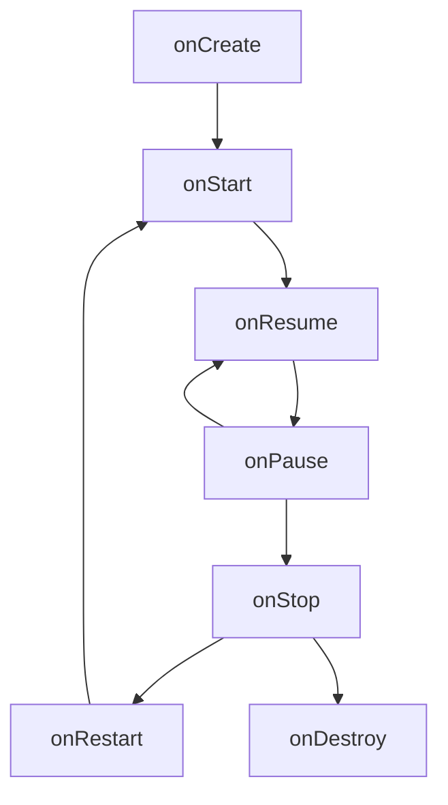

# Week 6 — Android

Source: **A** in the [lecture source index](lecture-source-index.md). References use **1-based PDF viewer pages**. Code fragments below illustrate the lecture's Android framework APIs; they belong inside an Android project rather than a standalone Java program.

## 1. App basics and components

Android apps can use Java, Kotlin and C++; an APK packages an installable app. Android manages application components and permissions rather than starting your code through a conventional Java `main()`. [A pp. 2–4, 7]

| Component | Role |
|---|---|
| Activity | A screen/entry point for user interaction |
| Service | Background work without a UI |
| BroadcastReceiver | Responds to broadcasts such as system events |
| ContentProvider | Manages access to a shared set of app data |

[A p. 4]

## 2. Activity lifecycle

| Callback | Meaning |
|---|---|
| `onCreate()` | Initialise the activity and load its layout |
| `onStart()` | Become visible |
| `onResume()` | Enter foreground interaction |
| `onPause()` | Lose foreground interaction; may remain visible |
| `onStop()` | Become invisible |
| `onRestart()` | Prepare to return after being stopped |
| `onDestroy()` | Activity is being destroyed |

Typical launch: `onCreate → onStart → onResume`. Return from pause: `onResume`. Return from stop: `onRestart → onStart → onResume`. The lecture diagram also shows process termination, so do not rely on `onDestroy()` as a guaranteed save callback. [A pp. 8–10]



This diagram summarises the ordinary callback routes; process death is not drawn. Configuration changes such as rotation can recreate the activity, so initialise its UI again and consider what state needs saving/restoring. [A pp. 9, 99–102]

## 3. Intents

An **Intent** carries an action, destination/data and information needed by the receiving component. [A pp. 5–6]

| Type | How the destination is chosen |
|---|---|
| Explicit | Name the component class, commonly within your app |
| Implicit | Describe an action; Android resolves a capable component |

Lecture-style fragment inside an activity:

```java
Intent intent = new Intent(getApplicationContext(), ActivityB.class);
startActivity(intent);
```

For navigation and passing values between activities, see the walkthrough at **A pp. 60–87**. An explicit intent selects the destination; additional data must be added and read separately.

## 4. UI, layouts and resources

**View** is a widget such as a button or text field. **ViewGroup** is a container/layout that positions child views. XML declarations separate presentation from Java behaviour, while code can also create or modify views at runtime. [A pp. 14–18]

| Resource/API | Purpose |
|---|---|
| `res/layout/activity_main.xml` | Layout definition |
| `MainActivity.java` | Activity behaviour |
| `setContentView(R.layout.activity_main)` | Load layout in `onCreate` |
| `findViewById(R.id.mybutton)` | Obtain an inflated view by ID |
| `@+id/mybutton` | Declare a new resource ID |
| `wrap_content` | Size to content, including padding |
| `match_parent` | Size relative to the parent layout |

[A pp. 12, 18–19]

```xml
<Button
    android:id="@+id/mybutton"
    android:layout_width="wrap_content"
    android:layout_height="wrap_content"
    android:text="Click me" />
```

The fragment belongs inside a layout with the Android XML namespace declared.

```java
@Override
protected void onCreate(Bundle savedInstanceState) {
    super.onCreate(savedInstanceState);
    setContentView(R.layout.activity_main);
    // Obtain this layout's views after it has been inflated.
}
```

**LinearLayout** arranges children in a row or column; **ConstraintLayout** positions/sizes widgets using constraints. For dynamic data, an **Adapter** supplies views to an `AdapterView`, such as `ListView` or `GridView`; `ArrayAdapter` is one supplied implementation. [A pp. 15–16, 20–22]

## 5. Events and feedback

Register listeners to react to user interaction: `onClick`, `onLongClick`, `onFocusChange`, `onKey`, `onTouch`, `onCreateContextMenu`. The framework calls the callback when the associated event occurs. [A pp. 24–25]

```java
button.setOnClickListener(v -> {
    // Respond to the click.
});
```

A **Toast** provides brief popup feedback. [A p. 26]

```java
Toast.makeText(getApplicationContext(), "Hello!",
               Toast.LENGTH_SHORT).show();
```

Styles specify view appearance; themes apply styling across an app, activity or view hierarchy. [A pp. 27–28]

## 6. Location and permissions checklist

The location walkthrough separates **declaration**, **permission checking/requesting** and **using the service**:

1. Declare the needed location permissions in `AndroidManifest.xml`.
2. Obtain `LocationManager` and define a `LocationListener`.
3. Check the required runtime permission and request it if needed.
4. Request location updates only when the permission requirements are met.
5. Handle `onLocationChanged` and read latitude/longitude from the received `Location`.
6. For emulator testing, configure its simulated location.

[A pp. 111–125]

The lecture lists `ACCESS_FINE_LOCATION` and `ACCESS_COARSE_LOCATION`. A manifest declaration does not replace the runtime permission flow shown in the walkthrough. Returning from a permission request does not itself mean permission was granted. [A pp. 111, 117–122]

These notes describe the supplied course example; actual platform behaviour depends on the Android version and project configuration.

## 7. Pair programming

Two people work together on one machine. The **driver** operates the keyboard and focuses on the immediate task; the **navigator** reviews, considers broader issues and identifies next steps. Agree on small goals and switch roles regularly. [A pp. 32–34]

**Ping-pong TDD:** A writes a failing test → B writes the implementation to pass it → switch roles. Include refactoring after passing tests: **red → green → refactor**. Take breaks and avoid micromanaging the driver. [A pp. 35–40]

## 8. Fast source lookup

| Need | PDF pages |
|---|---|
| Components / intents | A 4–6 |
| Activity lifecycle | A 8–11 |
| Layouts, resources, adapters | A 12–22 |
| Listeners, Toasts, themes | A 24–28 |
| Pair programming | A 30–42 |
| Create/run an Android Studio project | A 43–57 |
| Navigate and pass data between activities | A 60–87 |
| Orientation/configuration changes | A 93–103 |
| Location and permissions | A 104–125 |
