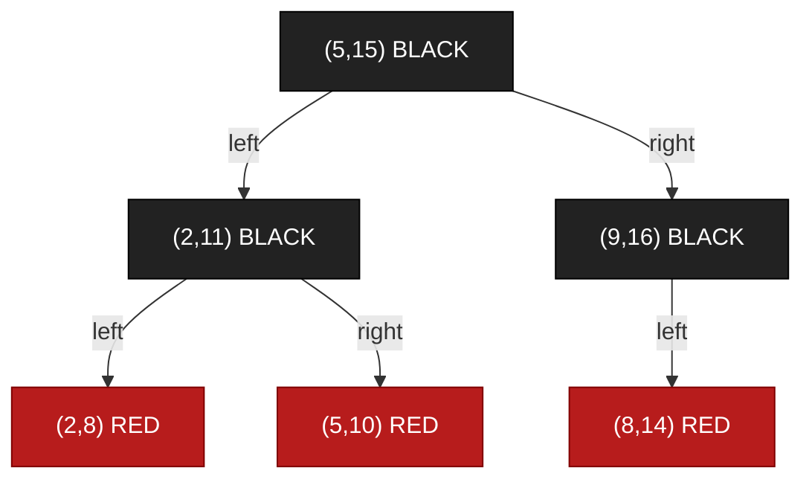

# Quiz 002 — Red-Black Tree with Interval Keys

- **Topic:** Data structures: interval comparison, red-black insertion and pre-order traversal
- **Original label:** Question 4 (quiz week not supplied)
- **Question source:** Quiz screenshot shared for revision
- **Review outcome:** Answered correctly using the study notes
- **Reviewed:** 3 November 2026
- **Lecture source:** **D**, `week03-data-structures(3).pdf`: pre-order traversal on **PDF pp. 33–34**; insertion and repair on **pp. 94–103**. Count the cover as page 1.

## Question

Consider a red-black tree whose keys are intervals. An interval is represented by `(startTime, endTime)`.

For a pair of intervals `i1, i2`, we write `i1 < i2` if:

1. `i1.startTime < i2.startTime`, or
2. `i1.startTime = i2.startTime` and `i1.endTime < i2.endTime`.

Build a red-black tree by adding the following keys in this order:

`(9,16), (5,15), (5,10), (8,14), (2,11), (2,8)`

If you walk through the final tree using **pre-order traversal**, what is the correct node and colour output?

Only the correct answer option is visible in the supplied screenshot. Other options are not reconstructed here.

<strong>Answer and explanation</strong>

## Correct answer

**(5,15) BLACK, (2,11) BLACK, (2,8) RED, (5,10) RED, (9,16) BLACK, (8,14) RED**

## 1. Compare the interval keys

Use **lexicographic order**: compare start times first; compare end times only when start times are equal.

- `(5,10) < (5,15)`: equal start times, and `10 < 15`.
- `(2,8) < (2,11)`: equal start times, and `8 < 11`.
- `(8,14) > (5,15)`: `8 > 5`, regardless of the end times.

The sorted order is:

`(2,8) < (2,11) < (5,10) < (5,15) < (8,14) < (9,16)`

This order determines left/right placement. **Keep the insertion order given in the question**; do not insert the keys in sorted order.

## 2. Insert and repair

Use the conventional bottom-up red-black insertion taught in the lecture: insert as a red BST leaf, repair a red-red conflict, and finish with a black root. Missing children are black NIL leaves. **[D, pp. 94–103]**

| Step | Insert | Placement and repair |
| --- | --- | --- |
| 1 | `(9,16)` | First node becomes the root; colour it **black**. |
| 2 | `(5,15)` | Insert as the red left child of `(9,16)`. Parent is black; no repair. |
| 3 | `(5,10)` | Insert left of red `(5,15)`. Parent is red, uncle is black NIL: **LL case**. Colour `(5,15)` black and `(9,16)` red, then right-rotate at `(9,16)`. New root: `(5,15)`. |
| 4 | `(8,14)` | Insert as the red left child of `(9,16)`. Parent `(9,16)` and uncle `(5,10)` are both red: recolour both black and the grandparent `(5,15)` red. Restore the root to black. **No rotation.** |
| 5 | `(2,11)` | Insert as the red left child of black `(5,10)`. No repair. |
| 6 | `(2,8)` | Insert left of red `(2,11)`. Uncle is black NIL: **LL case** at `(5,10)`. Colour `(2,11)` black and `(5,10)` red, then right-rotate at `(5,10)`. Root remains `(5,15)`. |

**Repair references:** red-uncle recolouring **D, pp. 99–100**; black-uncle outer/LL repair **D, p. 102**. This worked interval trace applies those rules to the supplied question.

## 3. Final tree

Colours are shown both visually and in the labels. NIL leaves are omitted.

Notice that `(5,10)` belongs in the root's **left subtree**, even though its start time equals the root's start time: its end time is smaller.

## 4. Read pre-order: Node → Left → Right

Visit the current node before recursively visiting its left and right subtrees. **[D, pp. 33–34]**

| Visit | Node | Colour |
| ---: | --- | --- |
| 1 | `(5,15)` | BLACK |
| 2 | `(2,11)` | BLACK |
| 3 | `(2,8)` | RED |
| 4 | `(5,10)` | RED |
| 5 | `(9,16)` | BLACK |
| 6 | `(8,14)` | RED |

Pre-order visits `(9,16)` **before** its left child `(8,14)`, because each subtree is traversed node-first. Inorder would produce the sorted sequence instead.

## 5. Check the result

- The root is black.
- No red node has a red child.
- The BST ordering agrees with the interval comparator.
- Every root-to-NIL path has the same black count: **3 when counting the root and NIL**. For example, root → `(2,11)` → `(2,8)` → NIL and root → `(9,16)` → NIL both have three black nodes.

For verification, the intervals were replaced by their sorted ranks:

| Interval | Rank |
| --- | ---: |
| `(2,8)` | 1 |
| `(2,11)` | 2 |
| `(5,10)` | 3 |
| `(5,15)` | 4 |
| `(8,14)` | 5 |
| `(9,16)` | 6 |

The equivalent insertion sequence `6,4,3,5,2,1` was run through the repository's [red-black Java example](../examples/RedBlackTreeDemo.java). Its invariant checks passed after every insertion, and the verified pre-order was `4B,2B,1R,3R,6B,5R`, matching the answer above.

### Memory aid

**Compare → insert red → inspect parent and uncle → repair → traverse the final tree.**

Equal start times require an end-time comparison; red uncle means recolouring; a black-uncle LL conflict means a right rotation with recolouring.

## Related revision

- [BST, red-black and AVL notes](../notes/week-03-data-structures.md)
- [Red-black insertion: diagrams and worked examples](../notes/week-03-red-black-insertion.md)
- [Lecture source index](../notes/lecture-source-index.md)

[Back to quiz index](README.md)
