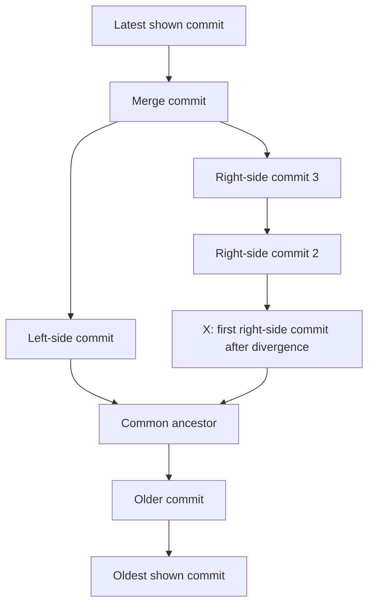

# Quiz 004 - Identify a commit in a Git history graph

- **Topic:** Git / version control
- **Original question number:** Not visible in the supplied screenshot.
- **Course resource:** The screenshot identifies `comp2100/student-resources/week-02-quiz`.
- **Answer status:** Method explained; exact short hash still requires the repository log.

## Question

Access [the ANU GitLab quiz repository](https://gitlab.comp.anu.edu.au/comp2100/student-resources/week-02-quiz). Its history is displayed with commit details hidden:

```bash
git --no-pager log --graph --format='%x20' --all
```

What is the short hash of the commit marked X?

The following diagram reproduces the ancestry visible in the screenshot. Labels other than X are explanatory labels, not actual commit messages or branch names. Arrows point from a commit to its parent, so history becomes older down the diagram.



<details>
<summary><strong>Answer and explanation</strong></summary>

**You cannot recover the actual hash from the stripped graph alone.** This is a repository-inspection task: display the identifiers, then match the graph position.

A commit is a saved version in Git history. Its hash is its identifier; a short hash is an abbreviated form of that identifier. It is not a row number or a branch name.

### 1. Open the repository locally

If you have not cloned it:

```bash
git clone https://gitlab.comp.anu.edu.au/comp2100/student-resources/week-02-quiz.git
cd week-02-quiz
```

Use your normal ANU GitLab authentication if requested. If it is already cloned, open a terminal inside that repository.

### 2. Reveal the hidden details

```bash
git --no-pager log --graph --format='%h %s' --all
```

| Format | Meaning |
| --- | --- |
| `%x20` | A space character: the original command deliberately hides the commit details. |
| `%h` | Abbreviated commit hash. |
| `%s` | Commit message subject. |

The command preserves the graph options while replacing the blank output with useful details. For example, an illustrative entry `a1b2c3d Add tests` would have short hash `a1b2c3d`; **this is an invented example, not the quiz answer**.

### 3. Match X

- Each `*` in the terminal graph marks a commit.
- Connecting lines show ancestry.
- X is beside the **lowest of the three right-hand commits** in the supplied graph.
- It is the first commit along that right-hand path after the common ancestor when following development forward in time.
- Copy the short hash next to that commit.

If the repository has acquired more commits, match the surrounding branch/merge structure rather than relying on an absolute row number.

### Why no numerical answer is supplied yet

The repository history could not be retrieved during this review. The screenshot intentionally removes the information needed to identify the exact hash. A screenshot or pasted output of the command above is sufficient to complete the answer.

</details>

## Common mistake

Trying to calculate a hash from the number of stars or their positions. The graph gives relationships; the repository supplies the identifiers.

**Memory aid:** Graph = ancestry; hash = identity; `%h` reveals the short hash.

## Sources

- User-supplied quiz screenshot and its linked ANU GitLab resource.
- [Official Git pretty-format documentation](https://git-scm.com/docs/pretty-formats), for `%x20`, `%h`, and `%s`.
- No lecture PDF page is assigned: an exact slide source for this Git exercise has not been verified.

[Back to quiz index](README.md)
