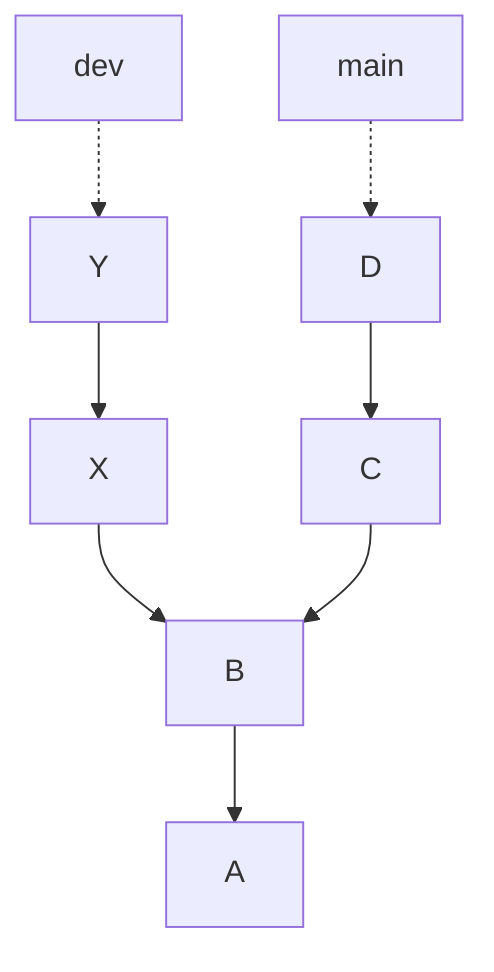

# Quiz 010: What does a Git branch represent?

[Back to quiz index](README.md)

- **Topic:** Git / version control
- **Original question:** Question 1; quiz week not supplied.
- **Added:** 5 November 2026.

## Question

A Git repository has the following commit tree. The `dev` path diverges from the `main` path at B.

The diagram below redraws the supplied graph. Solid arrows point from a commit to its parent; dashed arrows show branch references.

**Internally, what does the branch `dev` represent?**

### Options

- **A.** The branch dev owns copies of commits X and Y.
- **B.** The branch dev is merely a pointer to commit Y.
- **C.** The branch dev owns copies of commits B, X, and Y.
- **D.** The branch dev owns copies of commits A, B, X, and Y.

<strong>Answer and explanation</strong>

**Correct answer: B — The branch dev is merely a pointer to commit Y.**

A Git branch is a named, movable reference to a commit. Here, `dev` points directly to Y, and `main` points directly to D.

### A reference versus reachable history

| Item | Meaning in this graph |
| --- | --- |
| `dev` | A branch reference pointing directly to Y. |
| Y | A commit whose parent is X. |
| X | A commit whose parent is B. |
| B | The common ancestor of the two paths; its parent is A. |
| History reachable from `dev` | Y, X, B and A, found by following parent links. |

Being reachable from a branch does **not** mean a commit is a separate copy owned by that branch. A and B are shared history reachable from both branch tips.

### Why the other options are incorrect

| Option | Assessment |
| --- | --- |
| A | X and Y are on the dev path, but `dev` does not own copies of them. |
| B | Correct: it identifies the commit referenced directly by `dev`. |
| C | Again assumes branch-owned copies; it also omits reachable ancestor A. |
| D | Lists all commits reachable from `dev`, but incorrectly describes them as owned copies. |

### What happens after another commit?

As an additional example, suppose you check out `dev` and make a normal new commit Z. Z has Y as its parent, and `dev` moves to Z. `main` stays at D.

The screenshot does not identify the checked-out branch. In normal attached operation, `HEAD` refers to that current branch; it is distinct from the branch reference itself.

## Common mistake

Confusing **the single commit a branch directly references** with **all commits reachable through its history**.

**Memory aid:** Branch = movable label; commit parent links = history.

## Sources

- User-supplied quiz screenshot: Question 1 and its accepted answer.
- [Official Git book: Branches in a Nutshell](https://git-scm.com/book/en/v2/Git-Branching-Branches-in-a-Nutshell): branch pointers, commit parents and `HEAD`.
- No lecture PDF page is assigned because an exact slide reference has not been verified.

[Related quiz: reading a Git history graph](004-git-history-short-hash.md) · [Back to quiz index](README.md)
