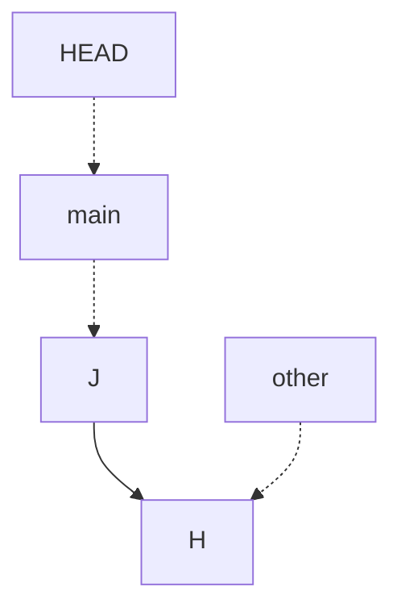

# Quiz 011: HEAD after creating a branch and committing

[Back to quiz index](README.md)

- **Topic:** Git / version control
- **Original question:** Question 3; quiz week not supplied.
- **Added:** 5 November 2026.

## Question

In a Git repository, HEAD and the branch main both point to commit H. A user runs `git branch other` and then creates a commit J. Where do HEAD, main, and other point?

### Options

- **A.** main points to H; HEAD and other point to J.
- **B.** other points to H; HEAD and main point to J.
- **C.** main and HEAD point to H; other points to J.
- **D.** other and HEAD point to H; main points to J.

<strong>Answer and explanation</strong>

**Correct answer: B — other points to H; HEAD and main point to J.**

The quiz assumes that `main` is currently checked out. Its wording that HEAD "points to H" describes the commit reached through the current branch. More precisely, in this attached state HEAD refers to `main`, which refers to H.

### Follow the operations

| Step | Current branch | main | other | Commit reached by HEAD |
| --- | --- | --- | --- | --- |
| Initially | main | H | Does not exist | H |
| After `git branch other` | main | H | H | H |
| After committing J | main | J | H | J |

1. Creating `other` places a new branch reference at H.
2. `git branch other` does **not** switch the current branch.
3. The new commit J therefore advances `main`. J records H as its parent.
4. HEAD still refers to `main`, now reaching J. The unused `other` reference stays at H.

Final relationships:

Dashed arrows show references; the solid arrow shows J's parent.

### Creating versus switching

| Command | Effect |
| --- | --- |
| `git branch other` | Create other at the current commit; stay on the current branch. |
| `git switch other` | Switch to an existing branch named other. |
| `git switch -c other` | Create other and switch to it. |

As a separate practice variant, if the user had run `git switch -c other` before committing J, then other and HEAD would reach J, while main would remain at H. That would match option A, but it is a different command from the one in the question.

### Why the alternatives are incorrect

| Option | Reason |
| --- | --- |
| A | Assumes that creating other also switched to it. |
| B | Correct: main advances, HEAD follows main, and other stays at H. |
| C | Moves other even though main is still checked out. |
| D | Moves main but incorrectly leaves HEAD at H despite HEAD referring to main. |

## Common mistake

Treating branch creation as a branch switch, or treating HEAD as the most recently created branch.

**Memory aid:** Create does not switch. A normal commit advances the current branch.

## Sources and related notes

- User-supplied Question 3 screenshot and its accepted answer.
- [Official Git book: Branches in a Nutshell](https://git-scm.com/book/en/v2/Git-Branching-Branches-in-a-Nutshell), for branch creation, HEAD and branch movement.
- No lecture PDF page is assigned because an exact slide reference has not been verified.
- [Quiz 010: What does a Git branch represent?](010-git-branch-pointer.md)
- [Back to quiz index](README.md)
