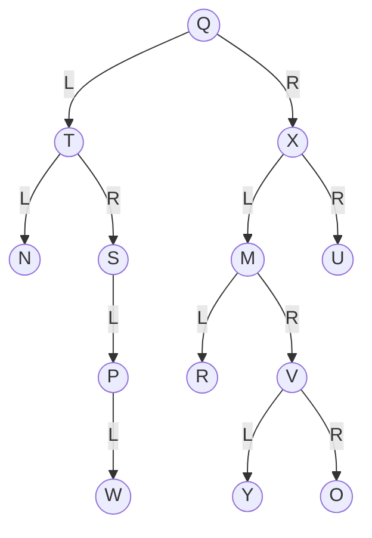

# Quiz 019: Neighbours in a pre-order traversal

**Original label:** Question 3; quiz week not supplied.  
**Topic:** Binary-tree traversal: root, left, right.  
[Back to quiz index](README.md)

## Question

Consider the following binary search tree with root Q.

L and R on edges denote left and right children. The node named R is a node label.

If the tree is traversed in pre-order traversal, the nodes that come immediately before and after M are respectively:

1. R and Y
2. X and U
3. X and V
4. X and R
5. R and V

<strong>Answer and explanation</strong>

**Correct answer: option 4 — X and R.**

Pre-order visits **Node → Left subtree → Right subtree (NLR)**, applying the same rule recursively at every node.

The complete traversal is:

**Q → T → N → S → P → W → X → M → R → V → Y → O → U**

Around M, the sequence is **X → M → R**:

- Visit X, then enter its left subtree rooted at M.
- Visit M, then its left child R.
- Only after finishing M's left subtree do we visit its right subtree rooted at V.

### Why the other choices are wrong

| Option | Reason |
| --- | --- |
| R and Y | R follows M; Y is visited later inside V's subtree. |
| X and U | X is immediately before M, but U comes after the entire subtree rooted at M. |
| X and V | X is correct, but R must be visited before V. |
| R and V | These are M's children, not its immediate neighbours in pre-order. |

### Common trap

Do not confuse neighbours in the traversal with a node's children, or with predecessor/successor in sorted order.

The prompt calls this a binary search tree, but the displayed letters are not alphabetically ordered as BST keys. Treat them as node labels and follow the drawn edges; pre-order does not require key comparisons.

### Memory aid

**Pre-order: root first → left → right.**

Related: [Pre-order traversal with interval keys](002-red-black-interval-preorder.md).
