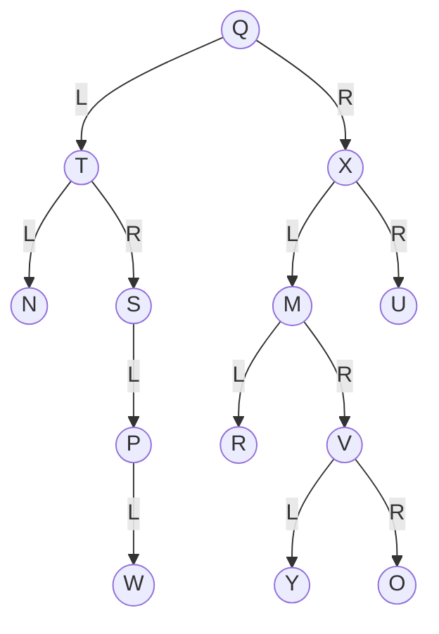

# Quiz 024: Neighbours in a post-order traversal

**Original label:** Question number and quiz week not visible.  
**Topic:** Binary-tree traversal, left then right then root.  
[Back to quiz index](README.md)

## Question

Consider the following tree with root Q. The question uses the same diagram as [Quiz 019](019-preorder-traversal-neighbours.md).

The edge labels L and R indicate left and right children. R inside a circle is a node label.

In a post-order traversal, which nodes come immediately before and after Y, respectively?

1. M and O
2. R and O
3. R and V
4. M and V
5. V and O

<strong>Answer and explanation</strong>

**Correct answer is option 2, R and O.**

Post-order visits **the left subtree, then the right subtree, then the root**. Apply the same rule recursively to each subtree.

Focus on the subtree rooted at M:

1. Visit M's left child R.
2. In M's right subtree, visit V's left child Y and then its right child O. Visit V after both.
3. Visit M last.

The local order is **R → Y → O → V → M**, so R immediately precedes Y and O immediately follows it.

The full post-order traversal is **N → W → P → S → T → R → Y → O → V → M → U → X → Q**.

| Option | Reason |
| --- | --- |
| M and O | O follows Y, but M is visited after its descendants. |
| R and O | Both are the immediate neighbours of Y. |
| R and V | R precedes Y. O must be visited before V. |
| M and V | Both M and V are visited after Y, with O in between Y and V. |
| V and O | O follows Y. V comes after both of its children. |

## Common mistake

Visiting V as soon as you reach it. In post-order, wait until both subtrees of V have been visited. The letters are node labels, and the drawn edges determine the order.

Related: [Pre-order traversal on the same tree](019-preorder-traversal-neighbours.md). The supplied quiz screenshots confirm the tree, options and answer.
