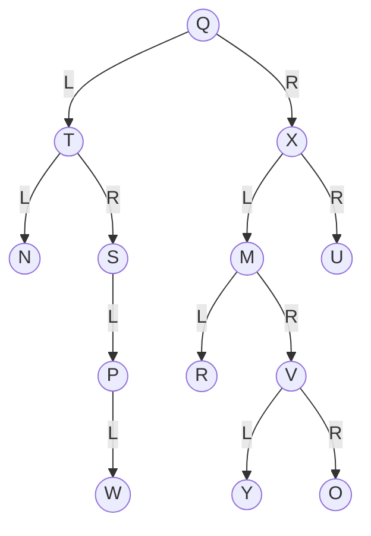
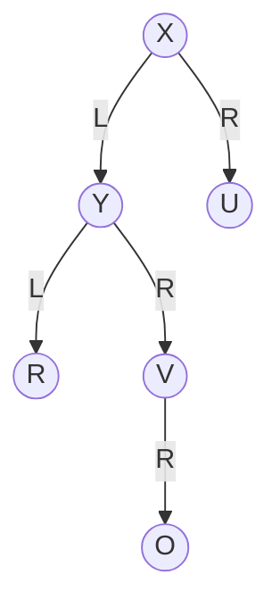

# Quiz 029: Delete a BST node with two children

**Original label:** Question 3; quiz week not supplied.  
**Reviewed:** 10 November 2026.  
**Topic:** BST deletion, in-order successor and predecessor.  
[Back to quiz index](README.md)

## Question

Consider the following binary search tree with root Q.

Edges labelled L and R indicate left and right children. R inside a circle is a node label.

Currently, the left child of X is M. If node M were deleted from the tree by the standard algorithm, then the left child of X might become:

1. Y
2. null
3. O
4. T
5. V

<strong>Answer and explanation</strong>

**Correct answer: option 1, Y.** The supplied quiz screenshot confirms full credit.

M has two children. The usual BST deletion procedure can replace it with its **in-order successor**, the smallest key in its right subtree.

1. Go right from M to V.
2. Go left from V to Y.
3. Y has no left child, so Y is the successor.
4. Put Y in M's position and remove Y from its original position.

In this example, Y is a leaf, so its old position simply becomes empty. The affected subtree becomes:

The rest of the tree stays the same.

### Why does the question say “might”?

A standard alternative uses the **in-order predecessor**, the largest key in the left subtree. For M, that node is R. R could therefore replace M under that variant, but R is not among the options.

| Replacement rule | Search from M | Result |
| --- | --- | --- |
| Successor | Right once, then left as far as possible | Y |
| Predecessor | Left once, then right as far as possible | R |

The local in-order sequence before deletion is **R → M → Y → V → O**. Y immediately follows M, while R immediately precedes it.

### Why the other options are incorrect

| Option | Reason |
| --- | --- |
| null | M has descendants that must be retained; its replacement position is not empty. |
| O | O is not the smallest node in M's right subtree. |
| T | T is outside M's subtree and is neither its successor nor its predecessor. |
| V | V has a left child Y, so V is not the leftmost node in the right subtree. |

## Common mistakes

- Choosing the immediate right child without checking for left descendants.
- Sorting the letters alphabetically. The diagram is not a valid BST if those letters are interpreted as alphabetical keys. The intended question treats them as node identifiers; follow the drawn structure and the stated BST assumption.
- Forgetting to remove the successor from its old position after replacing the deleted entry.

**Memory aid:** Successor = right once, then all the way left. Predecessor = left once, then all the way right.

## Sources and related notes

- User-supplied Question 3 tree and marked answer, reviewed 10 November 2026.
- [Data structures notes](../notes/week-03-data-structures.md)
- [Lecture source index](../notes/lecture-source-index.md): successor/predecessor in D, PDF pp. 56–57 and 71; BST deletion in D, PDF pp. 71–75.
- Same tree: [pre-order traversal](019-preorder-traversal-neighbours.md) and [post-order traversal](024-postorder-traversal-neighbours.md).
