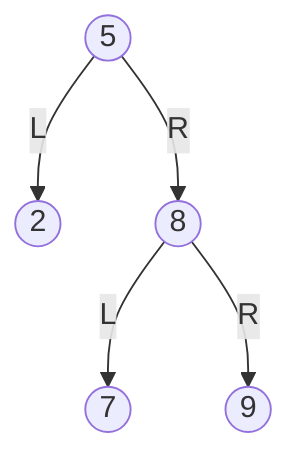
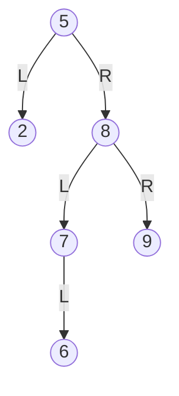
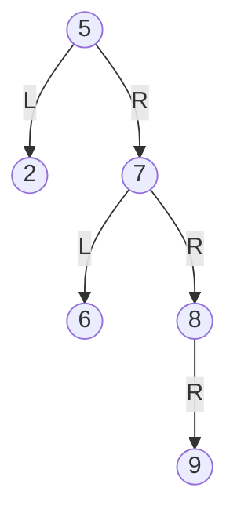
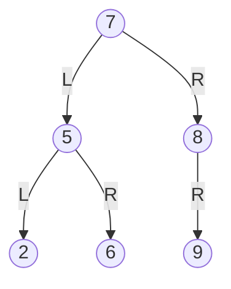

# Quiz 033: AVL right-left rotation after inserting 6

**Original label:** Question number and quiz week not visible in the supplied screenshot.  
**Reviewed:** 11 November 2026.  
**Topic:** AVL insertion, rotation directions and the first unbalanced ancestor.  
[Back to quiz index](README.md)

## Question

Consider this AVL Tree, with keys sorted in ascending order, and root node 5.

When the key 6 is inserted, what type of rotation, if any, would be performed to balance the tree?

1. Right-left
2. Left
3. Right
4. Left-right
5. No rotation

Edges labelled L and R denote left and right children.

<strong>Answer and explanation</strong>

**Correct answer: option 1, Right-left (RL).** The supplied screenshot marks this answer correct.

### First define the two basic rotations

A rotation changes local parent-child links while preserving BST ordering.

| Operation | Child promoted to subtree root | Where the old root moves |
| --- | --- | --- |
| Right rotation at a node | Its left child | Down to the right of the promoted child |
| Left rotation at a node | Its right child | Down to the left of the promoted child |

If the promoted child has a subtree whose keys lie between the two nodes, reattach that subtree to the old root. The movement of node 6 in the second rotation below illustrates this rule.

### 1. Insert 6 using BST ordering

The search path is **5 → 8 → 7 → 6**, taking **right → left → left**. The new node becomes the left child of 7.

### 2. Find the first unbalanced ancestor

Walk upward from the new node: check 7, then 8, then 5.

Use the same height convention as the data-structures notes: **empty subtree = -1; leaf = 0**. Define BF as left-subtree height minus right-subtree height.

| Node | Left height | Right height | BF | Balanced? |
| --- | ---: | ---: | ---: | --- |
| 7 | 0 | -1 | +1 | Yes |
| 8 | 1 | 0 | +1 | Yes |
| **5** | **0** | **2** | **-2** | **No** |

Thus **5 is the first unbalanced ancestor**. Equivalently, its left subtree has one level and its right subtree has three levels.

### 3. Identify the RL case

Starting at the unbalanced node:

- **5 → 8:** right.
- **8 → 7:** left.

The insertion occurred in the **left subtree of the right child of 5**, so this is **RL**.

The final left step from 7 to 6 does not turn the classification into LL. For insertion, classify the first two directions from the first unbalanced ancestor, not from an arbitrary node on the path.

The balance-factor test gives the same result: **BF(5) = -2** and its right child has **BF(8) = +1**.

### 4. Right-rotate at 8

Promote 7 above 8. Node 8 becomes 7's right child, while 6 remains 7's left child. Reconnect 5's right link to 7.

This is the intermediate tree. One more rotation is needed.

### 5. Left-rotate at 5

Promote 7 above 5. Node 5 becomes 7's left child.

The subtree containing 6 was on 7's left. It now becomes **5's right subtree**, because **5 < 6 < 7**.

The final root is **7**, and every node has a balance factor in {-1, 0, +1}.

The in-order sequence is still **2, 5, 6, 7, 8, 9**: all keys are retained in BST order.

### Why the other options do not fit

| Option | Reason |
| --- | --- |
| Right-left | Correct: right-rotate at 8, then left-rotate at 5. |
| Left | A single left rotation at 5 leaves the resulting subtree unbalanced; the inward lean needs the preliminary right rotation. |
| Right | A right rotation at 5 does not repair its right-heavy imbalance. |
| Left-right | LR applies when insertion is in the right subtree of the unbalanced node's left child. This tree has the opposite configuration. |
| No rotation | Node 5 has a subtree-height difference of 2. |

## Common mistakes

- Classifying the path 8 → 7 → 6 as LL without first noticing that 8 is still balanced.
- Rotating the same node twice: the RL repair here rotates **8 first, then 5**.
- Thinking a left rotation promotes the left child. It promotes the **right** child; the old root moves down to the left.
- Dropping node 6 or leaving it attached in the wrong position during the second rotation.

**Memory aid:** Find the first unbalanced ancestor, then inspect the two directions beneath it. Here: **5 → right to 8 → left to 7**, so **right-rotate 8, then left-rotate 5**.

## Sources and related notes

- User-supplied AVL insertion screenshot and marked answer, plus the follow-up discussion on rotation definitions.
- [Data structures notes: AVL trees](../notes/week-03-data-structures.md#5-avl-tree): D, PDF pp. 113–127.
- [Lecture source index](../notes/lecture-source-index.md)
- [BST deletion using successor or predecessor](029-bst-delete-node-with-two-children.md)
