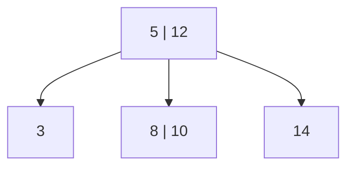
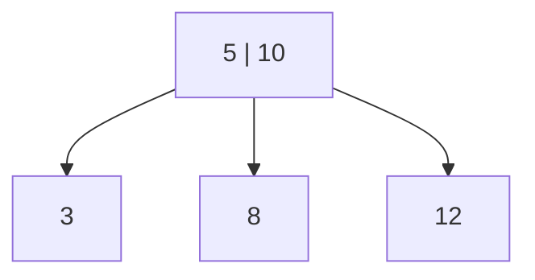

# 040 — B-tree deletion: borrow through the parent

Original label: **Question 3**; quiz week not supplied. Recorded 11 November 2026.

## Question

Consider the following B-tree with order 3. If the key 14 is removed, what keys will the root node and its children contain?

| Option | Result |
| --- | --- |
| a | (5,10) as the root, with children (3), (8), and (12) |
| b | (5,12) as the root, with children (3) and (8,10) |
| c | (5) as the root, with children (3) and (8,10,12) |
| d | (8) as the root, with children (3,5) and (10,12) |

Answer and explanation

**Correct answer: a. Root (5,10), with children (3), (8), and (12).**

In this course, order 3 means at most **3 children and 2 keys per node**. Each non-root node must contain at least one key.

1. Removing 14 leaves the right leaf empty, causing underflow.
2. Its adjacent left sibling (8,10) has two keys and can lend one.
3. Move the parent separator 12 down into the empty right leaf.
4. Move the sibling's largest key, 10, up to replace 12 in the parent.

Borrowing goes **through the parent** so that the ordering between subtrees remains correct.

| Alternative | Why it is not the expected answer |
| --- | --- |
| b | An internal node with two keys needs three children; the displayed result has only two. |
| c | The leaf (8,10,12) exceeds the maximum of two keys for order 3. |
| d | This is a structurally valid B-tree containing the remaining keys, but it is not the result of the standard local deletion and borrowing operation on the given tree. |

**Common mistake:** moving 10 directly into the right leaf while leaving 12 in the root. The right subtree must contain keys greater than its parent separator, so this would violate ordering.

**One-sentence summary:** When deletion causes a B-tree leaf to underflow, borrow from a sibling with spare keys by moving a parent separator down and a sibling key up.

## Lecture references

- **R, PDF pp. 60–67**, especially pp. 64 and 66: order, occupancy and minimum-key requirements.
- **R, PDF pp. 75–80**: deletion and underflow repair.
- R: `Week 07 - B-trees Refactoring - COMP2100_6442 - Semester 2 2026 (2)(4).pdf`.
- [Related notes](../notes/week-07-refactoring-and-b-trees.md) · [Lecture source index](../notes/lecture-source-index.md).

References use PDF viewer pages, counting the cover as page 1. The question and marked answer come from the supplied quiz screenshot.

[Back to quiz index](README.md)
