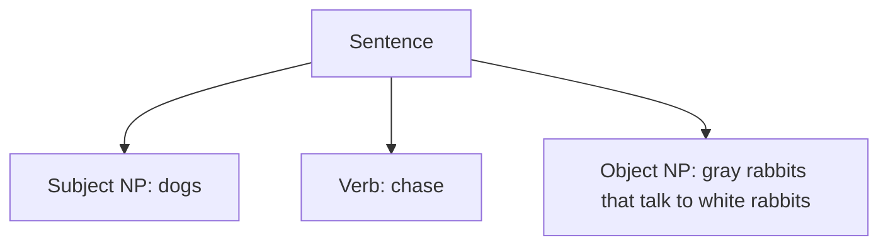

# 042 — Parse-tree root and the main verb

Original label: **Question 5**; quiz week not supplied. Recorded 11 November 2026.

## Question

Consider the grammar with initial symbol `sentence` and production rules:

```text
sentence → noun_phrase verb noun_phrase
noun_phrase → adjective noun_phrase | noun
            | noun_phrase "that" verb noun_phrase
noun → "cats" | "dogs" | "rabbits" | "people"
adjective → "white" | "black" | "gray" | "brown"
verb → "like" | "chase" | "talk to" | "see"
```

It is implemented with a tokeniser that ignores capitalisation and punctuation, and a recursive descent parser.

When applied to the input **“Dogs chase gray rabbits that talk to white rabbits.”**, what node would be at the root of the parse tree?

| Option | Root |
| --- | --- |
| a | a Sentence with verb="chase" |
| b | a Sentence with verb="talk to" |
| c | a Verb with string "chase" |
| d | a Verb with string "talk to" |

<details>
<summary>Answer and explanation</summary>

**Correct answer: a. A Sentence with verb="chase".**

The start symbol is `sentence`, so the complete parse has a Sentence at its root. Its production divides the input into:

| Role | Text |
| --- | --- |
| Subject noun phrase | dogs |
| Main verb | chase |
| Object noun phrase | gray rabbits that talk to white rabbits |



This diagram abbreviates the noun-phrase subtrees. The phrase **“that talk to white rabbits”** is nested within the object noun phrase and describes the rabbits. Its verb `talk to` is not the main verb of the whole sentence.

Strictly, the grammar's root label is `sentence`; the quiz describes its parser representation as a `Sentence` node whose main verb is `chase`.

| Alternative | Why it is incorrect |
| --- | --- |
| b | `talk to` belongs to the relative clause inside the object noun phrase. |
| c | `chase` is the correct main verb, but a Verb node is a child of the root, not the root itself. |
| d | `talk to` is both the wrong node type for the root and a nested verb. |

Ignoring capitalisation and punctuation allows `Dogs` to match `"dogs"` and the final full stop to be ignored; it does not change the grammatical hierarchy.

**Implementation caveat:** the rule `noun_phrase → noun_phrase "that" verb noun_phrase` is left-recursive. A naive recursive descent implementation cannot use it directly without rewriting the grammar or handling left recursion. This does not change the intended answer about the root of a successful parse.

**Common mistake:** choosing the last verb in the sentence instead of identifying the outermost `sentence → noun_phrase verb noun_phrase` structure.

**One-sentence summary:** The parse-tree root corresponds to the grammar's start symbol, and its main verb is “chase”; “talk to” belongs to a nested relative clause.

</details>

## Lecture references

- **P, PDF pp. 42–58**: grammars, start symbols, productions and ambiguity.
- **P, PDF pp. 59–69**: recursive descent; p. 69 discusses rewriting left recursion.
- P: `lecture_parsing - comp21006442 - s2 - 2026(1).pdf`.
- [Tokenisers and parsers notes](../notes/tokenisers-and-parsers.md) · [Lecture source index](../notes/lecture-source-index.md).

References use PDF viewer pages, counting the cover as page 1. The question and marked answer come from the supplied quiz screenshot.

[Back to quiz index](README.md)
